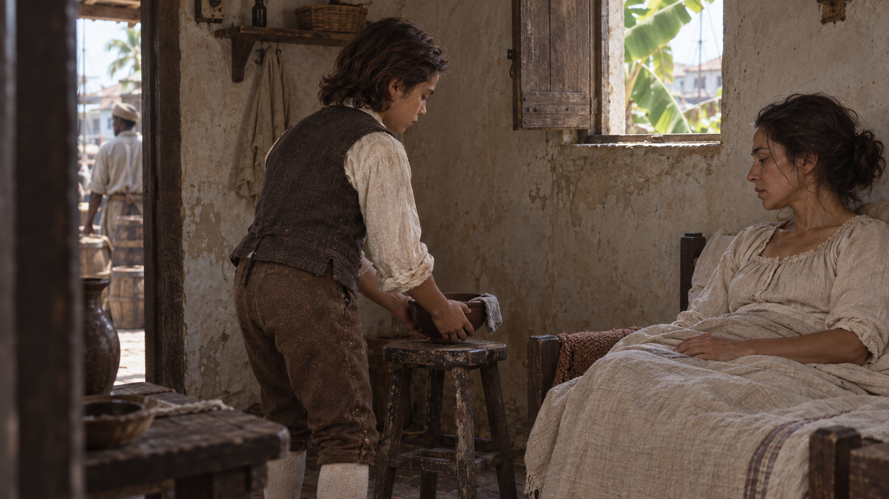
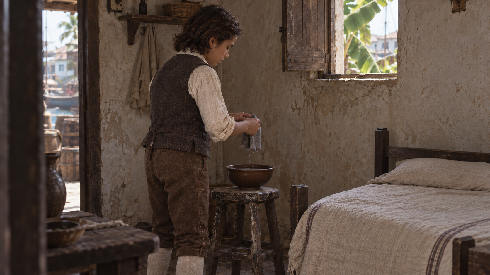
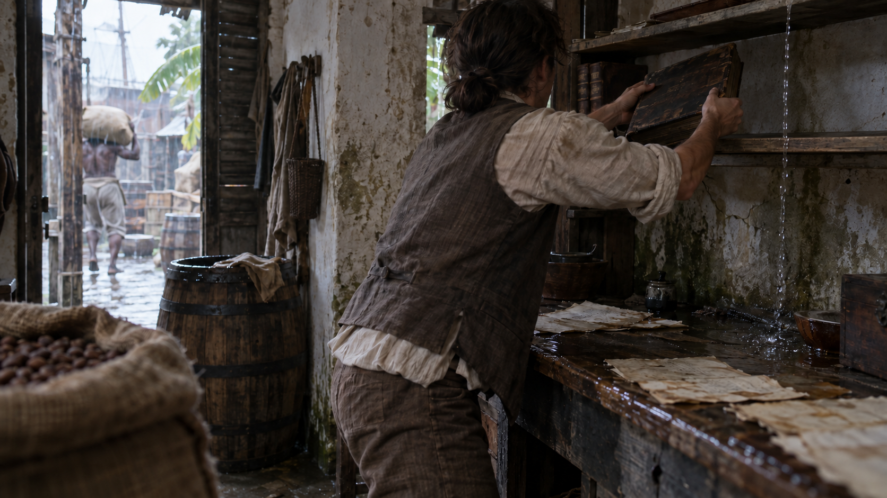
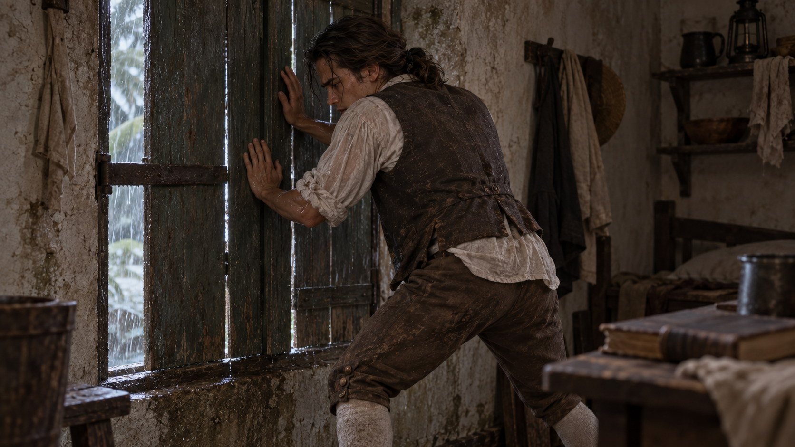
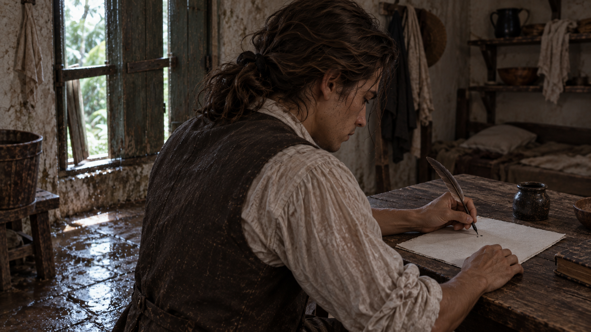
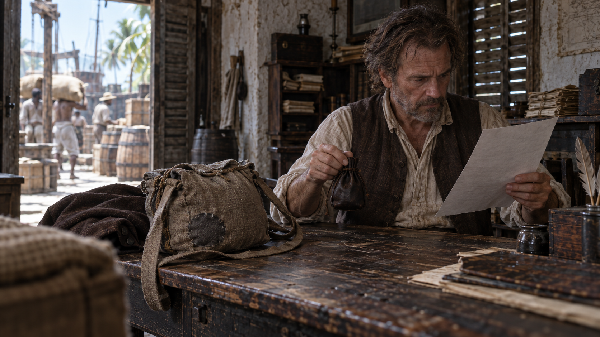
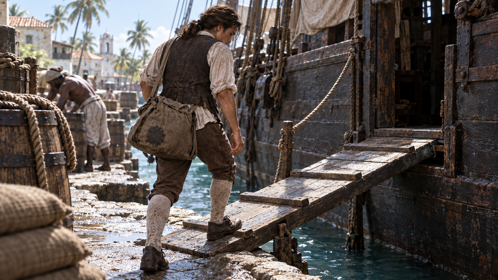

# Hamilton 开场 CG｜火山方舟 Seedance 2.5 操作手册

> 用户最新决定：停止额外视频测试，先用方舟API统一全部7张首帧，用户看完全部图片后再生成视频。当前制作见 [v4首帧制作](../cg-ark-firstframes-v4/制作说明.md)。下文的旧试片顺序仅保留为历史记录。

> 最新实测：方舟新首帧已成功生成S05，用户接受除字迹外的整体效果。[首条视频评审](reviews/S05-test-01/评审.md)记录了书写修正、非静音音轨及后续验证。原 `firstframes/S05.png` 仍是旧图；在统一正式首帧之前，不执行原清单全片生产。下文保留编剧和基础操作。

制作定稿 v3 · 2026-09-10 · 7个独立镜头 · 原始素材90秒 · 剪辑目标68秒

**这份手册可直接进入控制台测试。**包内已有7张逐镜首帧、7份完整中文视频提示词、最终分镜和剪辑表、API任务清单及批量脚本。没有生成或提交任何视频任务；方舟输入接受性、动态效果与最终画质仍须实测。

正文的“定稿”指编剧、镜头选择和操作配方已经收束；不代表未经生成的视频已经验收。旧A/B/C比较稿、旧舞台图和v2试帧不再作为操作入口。

## 先做这一条：S05 写作

1. 解压整个素材包，打开 `START-HERE.html`；保持 `firstframes`、`prompts`、`api` 和 `manifest.json` 的相对位置。HTML可以直接查看图片、复制提示词；也可阅读本Markdown手册。
2. 打开[Seedance 2.5 官方体验入口](https://ark.volcengine.com/region:cn-beijing/experience/vision?modelId=doubao-seedance-2-5-260628&tab=GenVideo)，登录你的火山方舟账号，确认当前模型为 **Seedance 2.5**。如账号尚未开通，按控制台提示先开通该模型；费用以你账号的实际显示为准。
3. 进入图片作为首帧的视频生成方式，只上传 `firstframes/S05.png` 一张。不要上传人物三视图，不填尾帧，不把7张图一起上传。界面标签可能调整，以“首帧输入”功能为准，本次未取得登录后控制台截图，不编造按钮坐标。
4. 复制 `prompts/S05.txt` 的全部文字到提示词栏。每份文件已经完整，无须另拼前缀、负面词或上下文；保留正常速度与固定机位要求。
5. 选 **12秒、720p、跟随首帧/自适应画幅、关闭声音**，输出选MP4（如界面提供格式选择）。首帧接近16:9，API的比例字段必须是 `adaptive`。不要另启用自动运镜、智能分镜或提示词扩写功能。
6. 检查模型与预计消耗，再由你点击生成。若页面没有声音开关，使用其API代码入口（如果提供）核对 `generate_audio=false`；若仍无法设置，可改用包内单镜API命令。仅在提示词写“无声”不能保证真正关闭音轨。
7. 成功后下载原始视频，记录模型、规格和任务ID。先确认人物素材被接受，再看右手执笔、左手压纸、少量书写、停笔以及镜头不漂移。画面里嘴唇也不应作说话动作；静音不能修复口型表演。
8. S05通过后，再以同样方法测试 **S07登船，15秒、720p**，检查脚与舷梯、行李和自然出画。两条通过后进入API生产。换到1080p仍是新的生成结果，不能假定与720p逐帧相同，仍需逐条验收。

参数与模式互斥依据[2.5官方教程](https://ark.volcengine.com/region:cn-beijing/docs/82379/2607688?lang=zh)及[创建任务文档](https://ark.volcengine.com/region:cn-beijing/docs/82379/1520757?lang=zh)。本手册的“测试”是普通生成，**不是** `draft=true` 样片模式。

## 固定参数

| 项目 | 控制台测试 | API正式生产 |
| --- | --- | --- |
| 模型 | Seedance 2.5 | `doubao-seedance-2-5-260628`；有自有接入点时才替换为真实Endpoint ID |
| 输入 | 每镜一张单幅首帧 | `image_url`，`role: first_frame` |
| 参考模式 | 首帧 | 不与 `reference_image` 混用 |
| 尾帧 | 留空 | 不提交 `last_frame` |
| 分辨率 | 720p | 1080p |
| 时长 | S01–S05：12秒；S06–S07：15秒 | 同左，明确设置 `duration` |
| 画幅 | 跟随首帧；素材接近16:9 | `ratio: adaptive`，不是 `16:9` |
| 声音 | 关闭 | `generate_audio: false` |
| 格式 | MP4 | `output_format: mp4` |
| 运镜 | 提示词固定机位 | 不添加不受2.5支持的 `camera_fixed` 字段 |
| 种子/样片 | 不设置 | 不添加 `seed`、`draft` 或 `service_tier: flex` |

2.5原生支持4–30秒；这里选择12/15秒给动作及剪辑留余量。声音关闭会同时关闭环境音，本片的雨、纸笔、脚步和水声在后期另做。1080p产物的HEVC/10bit兼容性应实测，不能把播放器无法解码误判为生成失败。[官方参数与规格](https://ark.volcengine.com/region:cn-beijing/docs/82379/1520757?lang=zh)

## 人脸输入若被拒绝，走哪条路

**不要把所有报错都当成提示词问题。**模型未开通、余额、文件格式、内容审核和网络错误分别处理；只有明确涉及人物/人脸输入时，才考虑以下分支。

现有图片是外部AI生成的虚构人物，不是拍摄的真人。官方未明确保证这类写实图片一定直接被接受；它们也不享受“本方舟账号原始模型产物”的豁免。所以先测S05，不能仅凭不露脸的商行图通过就推断全部人脸图都通过。[官方人像规则](https://ark.volcengine.com/region:cn-beijing/docs/82379/2608626?lang=zh)

若现有首帧被接受，继续使用本包；若被人脸输入审核拒绝：

1. 在**同一方舟账号**选择官方规则列明的 Seedream 5.0 lite/pro **文生图**，先用 `fallback-seedream/S05.txt` 生成一张写作首帧。这里是重新文生图，不是上传旧脸做图生图。
2. 保留该账号的原始生成产物，在有效期内直接用于Seedance 2.5；不要先截图、压缩、二次编辑或跨账号转发。官方受信任规则是近30天的原始产物，输入豁免不保证输出审核通过。URL需长期保存时，按官方建议原样转存TOS。
3. 先完成该新首帧的短视频测试，再重建其余所需首帧。`fallback-seedream` 已附逐镜纯文生图提示词，但重新生成**不能保证恢复本包相同的脸型、房间或道具**；童年前后、风灾与写作、旅行包必须重新比对。
4. 该分支生成的新图属于另一套素材，不与当前图随意混剪。确认后在新的素材包中替换首帧并保留来源，再生成新的运行记录；不要覆盖已有付费任务的运行记录来强行续跑。

这条备用路线遵循平台公开允许的素材来源，不是绕过审核。不要用虚构角色去冒造真人授权。若新产物仍被拒绝，保留错误码与任务记录，按平台规则处理，不连续重复付费提交。[官方受信任素材说明](https://ark.volcengine.com/region:cn-beijing/docs/82379/2608626?lang=zh)

## 最终编剧与剪辑表

故事主线：有人在身边、照料结束、独自谋生、风灾、书写、获得帮助、登船离开。采用顺叙，通过S02→S03的年龄变化省略数年；不使用闪回滤镜、日期字幕、对白或旁白。

S01/S02以照料关系和空床转译音乐剧中的失去母亲；**空床本身只明确表达缺席，不逐字说明死亡或死因。**S06把阅读与帮助压缩到一张桌上，S07用同款旅行包及实际登船补足去向。这是诗意的无对白序幕，不是完整童年年表。父亲离去、亲戚经历等未逐项重演。

商行经历、风灾与书信和资助有历史依据；水碗、放书、钱袋落点及具体登船动作属于原创调度。[Christiansted官方人物史](https://www.nps.gov/chri/learn/historyculture/people.htm) 写作置于灾后，遵循现存飓风书信的时间关系。[Hamilton飓风书信](https://founders.archives.gov/documents/Hamilton/01-01-02-0042)

生成和播放顺序不同：**先测S05、S07；成片仍按S01到S07。**以下是目标取用区间，最终依实际动作微调。不要为了凑时码剪断动作，也不要用慢动作或冻结帧填时长。

| 镜号 | 成片时间 | 内容 | 生成 | 初始取用区间 |
| --- | --- | --- | --- | --- |
| S01 | 00–07秒 | 照料仍在继续 | 12秒 | 原片1–8秒 |
| S02 | 07–14秒 | 位置空了 | 12秒 | 原片1–8秒 |
| S03 | 14–24秒 | 保护账册 | 12秒 | 原片1–11秒 |
| S04 | 24–34秒 | 风压 | 12秒 | 原片1–11秒 |
| S05 | 34–44秒 | 自己的文字 | 12秒 | 原片1–11秒 |
| S06 | 44–57秒 | 文章获得支持 | 15秒 | 原片1–14秒 |
| S07 | 57–68秒 | 登船离开 | 15秒 | 原片1–12秒 |

## 每镜操作卡

每次只上传本镜PNG，再复制本镜TXT。以下提示词已按实际首帧修正，不使用草案中的坐姿、夜间、重新迈上舷梯等旧描述。

### S01｜照料仍在继续



**上传：**[firstframes/S01.png](firstframes/S01.png)　**复制：**[prompts/S01.txt](prompts/S01.txt)　**生成：**12秒。

先建立母子间仍在发生的照料。 门内固定中景；母亲、孩子与碗处于同一空间。

```text
生成一条12秒、正常速度的连续实景电影镜头。以输入的单幅首帧为准确起点，保持人物身份、年龄、衣装、道具、空间与原有画幅。场景属于18世纪加勒比港镇。摄影机全程固定在首帧位置，焦距、对焦距离、取景范围不变；不推拉、不摇移、不环绕、不变焦、不拉焦、不手持晃动，不因人物移动而自动追拍。沿用首帧不均匀的自然光与真实使用痕迹，环境保持可辨，不增加美容光、舞台聚光、油画纹理、金尘或棕金滤镜。

首帧中孩子是站立的，双手托着水碗，碗已接近床边小凳，灰色湿布搭在碗沿；母亲坐靠床头，手放在被褥上。不要把孩子改成坐姿，不要改变母亲的位置。
0–1秒延续已有动作。1–3秒孩子把碗轻放到现有小凳中央，两手持续承托直到碗底落稳。3–5秒孩子松开碗，双手自然垂低至身体两侧。5–12秒维持站立，母亲保持原有坐姿与轻微自然呼吸，不伸手接碗、不饮水、不起身。灰布仍留在碗沿。门外原有背景人物只沿原方向缓慢离开，不进入房间。

只完成上述动作，不添加第二件事。人物不看镜头、不仰望、不微笑宣誓、不表演泪眼、不做说话口型。手指、物体接触、衣服和主要道具保持稳定，不穿透、不复制，不凭空增减人物或物品。无可读文字、字幕、标题或水印。无对白、独白、旁白、配音、歌唱、任何人声和背景音乐，输出无声。单镜头到底，不自动切镜，不蒙太奇，不溶解，不变形转场，不时间跳跃，不慢动作，不自动淡入淡出。
```

**看这两点：**

- 孩子保持站立，碗底先落稳再松手；母亲没有与孩子抢接碗。
- 碗和灰布位置稳定，结尾两人仍在场，有至少2秒可用停顿。

**优先修正句：**仅让站立孩子把已经接近凳面的碗放稳并撤手，母亲全程不伸手、不改变坐姿。

**剪辑：**碗落稳、孩子撤手后留停顿，硬切同机位的空床。

**后期声音：**陶碗轻触木凳、亚麻衣料；远处海风。

### S02｜位置空了



**上传：**[firstframes/S02.png](firstframes/S02.png)　**复制：**[prompts/S02.txt](prompts/S02.txt)　**生成：**12秒。

以照料物件仍在、母亲已缺席表达失去。 与S01相同的固定机位；空床保留在右侧。

```text
生成一条12秒、正常速度的连续实景电影镜头。以输入的单幅首帧为准确起点，保持人物身份、年龄、衣装、道具、空间与原有画幅。场景属于18世纪加勒比港镇。摄影机全程固定在首帧位置，焦距、对焦距离、取景范围不变；不推拉、不摇移、不环绕、不变焦、不拉焦、不手持晃动，不因人物移动而自动追拍。沿用首帧不均匀的自然光与真实使用痕迹，环境保持可辨，不增加美容光、舞台聚光、油画纹理、金尘或棕金滤镜。

本镜从开始就是另一时刻：床明确空置，只有同一个孩子。空床上是贴着床垫的薄被和枕头，不是盖着的人。孩子仍站在小凳旁，水碗已经放稳在凳上，双手持灰色湿布悬在碗上方。不要把S01的母亲上传作尾帧，不要在视频里表演任何人消失。
0–1秒自然保持。1–4秒孩子把手中湿布降低到现有陶碗靠近自己的碗沿，使布的一部分自然搭在碗沿。4–5秒松手，双手自然垂在身体两侧。5–12秒他继续站着，目光留在碗和手上，不坐下、不换位；空床、碗与灰布始终保持原位。床单不形成身体轮廓或呼吸，没有成人、幻影或新路人进入。

只完成上述动作，不添加第二件事。人物不看镜头、不仰望、不微笑宣誓、不表演泪眼、不做说话口型。手指、物体接触、衣服和主要道具保持稳定，不穿透、不复制，不凭空增减人物或物品。无可读文字、字幕、标题或水印。无对白、独白、旁白、配音、歌唱、任何人声和背景音乐，输出无声。单镜头到底，不自动切镜，不蒙太奇，不溶解，不变形转场，不时间跳跃，不慢动作，不自动淡入淡出。
```

**看这两点：**

- 空床从头至尾为空，没有母亲渐隐、床单人形或新成人出现。
- 孩子从站立持布变为布留碗沿、双手垂下；不变成坐姿。

**优先修正句：**始终只保留站立的孩子；完成一次把湿布放到碗沿并松手的动作，其余保持原位。

**剪辑：**手撤回身体两侧后停留；切到少年承托账册的双手。

**后期声音：**湿布轻触碗沿；窗外风声继续，室内更安静。

### S03｜保护账册



**上传：**[firstframes/S03.png](firstframes/S03.png)　**复制：**[prompts/S03.txt](prompts/S03.txt)　**生成：**12秒。

时间前进，少年已在商行谋生。 贴近左肩后的固定中景；柜台与门外货场共同交代劳动环境。

```text
生成一条12秒、正常速度的连续实景电影镜头。以输入的单幅首帧为准确起点，保持人物身份、年龄、衣装、道具、空间与原有画幅。场景属于18世纪加勒比港镇。摄影机全程固定在首帧位置，焦距、对焦距离、取景范围不变；不推拉、不摇移、不环绕、不变焦、不拉焦、不手持晃动，不因人物移动而自动追拍。沿用首帧不均匀的自然光与真实使用痕迹，环境保持可辨，不增加美容光、舞台聚光、油画纹理、金尘或棕金滤镜。

少年已经长大，变化由剪辑完成，本镜不变龄。首帧中他背侧朝向镜头，双手把一册合上的厚账册举在书架前；账册正后方的架面已经清空，右侧另有滴水。不要把账册放回桌上再重新抬起。
0–1秒稳住已托起的账册。1–4秒将账册在当前高度向前送入正前方清空的干燥架面，略放平，使底面先接触架板。4–6秒落稳后依次撤开双手。6–9秒手臂自然放低，上身放松少许，身体仍留在原有空隙，不转身展示脸。9–12秒停留，右侧滴水继续落到远离账册的湿台面。账册保持合上，不翻页、不写字、不拿第二件物品；门外工人只做低幅度的原有劳动，不横穿少年与书架之间。

只完成上述动作，不添加第二件事。人物不看镜头、不仰望、不微笑宣誓、不表演泪眼、不做说话口型。手指、物体接触、衣服和主要道具保持稳定，不穿透、不复制，不凭空增减人物或物品。无可读文字、字幕、标题或水印。无对白、独白、旁白、配音、歌唱、任何人声和背景音乐，输出无声。单镜头到底，不自动切镜，不蒙太奇，不溶解，不变形转场，不时间跳跃，不慢动作，不自动淡入淡出。
```

**看这两点：**

- 使用v3已清空的干燥落点，账册与架面不穿透，落稳后才撤手。
- 人物不重新取书、不转身，右侧漏水没有挪到已放好的账册上。

**优先修正句：**账册从当前架前位置直接放平到正前方空架面，落稳后再撤手；不移动书架、不再取书。

**剪辑：**账册落稳、双手撤下后切风灾；风声提前约0.3秒进入。

**后期声音：**屋顶雨、滴水、书册与木架摩擦。

### S04｜风压



**上传：**[firstframes/S04.png](firstframes/S04.png)　**复制：**[prompts/S04.txt](prompts/S04.txt)　**生成：**12秒。

风灾打断刚维持住的生活。 室内固定背侧中景；两只手与窗板接触清晰。

```text
生成一条12秒、正常速度的连续实景电影镜头。以输入的单幅首帧为准确起点，保持人物身份、年龄、衣装、道具、空间与原有画幅。场景属于18世纪加勒比港镇。摄影机全程固定在首帧位置，焦距、对焦距离、取景范围不变；不推拉、不摇移、不环绕、不变焦、不拉焦、不手持晃动，不因人物移动而自动追拍。沿用首帧不均匀的自然光与真实使用痕迹，环境保持可辨，不增加美容光、舞台聚光、油画纹理、金尘或棕金滤镜。

这是雨中的白昼，保持首帧可见的室外亮度，不改成夜晚。少年已经双掌压住木窗板，手的位置有高低，身体前倾；肩部不要求接触窗，脚部在画外，不安排换脚或补步。
0–2秒双掌维持现有接触与压力。2–6秒一阵风使原有木窗板仅向内轻微震动一两厘米；少年手掌不离木板，只用手腕、肘部和上身小幅增加压力，保持重心。6–9秒风压稍弱，窗板回到原有范围，他仍抵住。9–12秒继续维持受力状态。雨只从已有缝隙进入，窗、墙和房顶不突然断裂；不加入飞纸、玻璃、倒梁、爆炸或雷光频闪。

只完成上述动作，不添加第二件事。人物不看镜头、不仰望、不微笑宣誓、不表演泪眼、不做说话口型。手指、物体接触、衣服和主要道具保持稳定，不穿透、不复制，不凭空增减人物或物品。无可读文字、字幕、标题或水印。无对白、独白、旁白、配音、歌唱、任何人声和背景音乐，输出无声。单镜头到底，不自动切镜，不蒙太奇，不溶解，不变形转场，不时间跳跃，不慢动作，不自动淡入淡出。
```

**看这两点：**

- 雨中白昼不变夜晚；双掌持续接触窗板，没有肩膀或脚步重设。
- 木窗只小幅受压，人物有重量反应，窗和墙没有自行坍塌。

**优先修正句：**只保留双掌和上身对一次轻微风压的反应，手不离窗，不新增脚步、肩部接触或结构破坏。

**剪辑：**一次风压缓和时硬切灾后；风雨快速退为残留滴水。

**后期声音：**风压、木板低响、缝隙雨声；不做夸张雷击。

### S05｜自己的文字



**上传：**[firstframes/S05.png](firstframes/S05.png)　**复制：**[prompts/S05.txt](prompts/S05.txt)　**生成：**12秒。

从替商行保管账册，转为写下自己的见闻。 左肩后固定中近景；右手执笔、左手压纸，受损窗口仍可辨。

```text
生成一条12秒、正常速度的连续实景电影镜头。以输入的单幅首帧为准确起点，保持人物身份、年龄、衣装、道具、空间与原有画幅。场景属于18世纪加勒比港镇。摄影机全程固定在首帧位置，焦距、对焦距离、取景范围不变；不推拉、不摇移、不环绕、不变焦、不拉焦、不手持晃动，不因人物移动而自动追拍。沿用首帧不均匀的自然光与真实使用痕迹，环境保持可辨，不增加美容光、舞台聚光、油画纹理、金尘或棕金滤镜。

风灾已过，少年坐在干燥桌角。首帧中右手已经握着鹅毛笔，笔尖接近纸面；左手已经按在纸边，不重新安排手势。灰白纸、右上方深色墨瓶和后方受损木窗的位置都保持不变。
0–2秒保持短暂停顿，笔尖悬停或轻离纸面。2–7秒右手落笔，以正常速度写三到四组很短的连续笔画；左手一直压稳原有纸边。7–9秒笔尖抬离纸面少许，仍握在右手。9–12秒停笔，目光仍在纸上。不要写满整页，不生成清晰假英文，不蘸墨、不翻纸、不挪墨瓶，不突然抬头产生灵感。右手与左手不交换职责，落笔时光线不变化，窗外与桌角不会继续漏水到纸面上。

只完成上述动作，不添加第二件事。人物不看镜头、不仰望、不微笑宣誓、不表演泪眼、不做说话口型。手指、物体接触、衣服和主要道具保持稳定，不穿透、不复制，不凭空增减人物或物品。无可读文字、字幕、标题或水印。无对白、独白、旁白、配音、歌唱、任何人声和背景音乐，输出无声。单镜头到底，不自动切镜，不蒙太奇，不溶解，不变形转场，不时间跳跃，不慢动作，不自动淡入淡出。
```

**看这两点：**

- 右手执笔、左手压纸始终一致，笔尖接触与笔画对应。
- 书写少量后停笔，纸张、墨瓶、面容和袖口没有漂移。

**优先修正句：**右手只做三次很短的笔尖移动后停笔，左手压住同一纸边；不生成整行文字或额外蘸墨动作。

**剪辑：**完成少量笔画并停笔后切到读者手中的文章。

**后期声音：**笔尖摩擦纸面、衣料、少量滴水。

### S06｜文章获得支持



**上传：**[firstframes/S06.png](firstframes/S06.png)　**复制：**[prompts/S06.txt](prompts/S06.txt)　**生成：**15秒。

用阅读后的实际帮助连接到旅行。 桌角固定中景；纸、右手钱袋、左前景旅行包同框。

```text
生成一条15秒、正常速度的连续实景电影镜头。以输入的单幅首帧为准确起点，保持人物身份、年龄、衣装、道具、空间与原有画幅。场景属于18世纪加勒比港镇。摄影机全程固定在首帧位置，焦距、对焦距离、取景范围不变；不推拉、不摇移、不环绕、不变焦、不拉焦、不手持晃动，不因人物移动而自动追拍。沿用首帧不均匀的自然光与真实使用痕迹，环境保持可辨，不增加美容光、舞台聚光、油画纹理、金尘或棕金滤镜。

首帧中只有一名主要成年男读者：他的左手持一页文章，右手提着小深色皮钱袋，钱袋明确悬在桌面上方。桌左前方已放着灰褐亚麻旅行包，包上有深色近圆补丁、抽绳和宽布肩带。不要增加少年等候领钱，不改变持物左右手。
0–4秒读者继续看左手中的纸，右手原位提着钱袋。4–6秒左手把文章降低并平放到面前空桌面，纸实际接触桌面后撤开左手。6–10秒右手把原有钱袋轻放到紧挨旅行包的空桌面，袋底落稳后才松手。10–15秒双手停在桌边，文章、钱袋与旅行包都留在同一画面。先阅读、再放纸、最后放钱袋，顺序不能颠倒。不给任何人递钱，不握手、不点头、不鼓掌、不打开钱袋；旅行包不移动。门外工人只做远处低幅度劳动，不进入前景。

只完成上述动作，不添加第二件事。人物不看镜头、不仰望、不微笑宣誓、不表演泪眼、不做说话口型。手指、物体接触、衣服和主要道具保持稳定，不穿透、不复制，不凭空增减人物或物品。无可读文字、字幕、标题或水印。无对白、独白、旁白、配音、歌唱、任何人声和背景音乐，输出无声。单镜头到底，不自动切镜，不蒙太奇，不溶解，不变形转场，不时间跳跃，不慢动作，不自动淡入淡出。
```

**看这两点：**

- 同一男读者左手纸、右手钱袋；纸落稳后钱袋才落桌，钱袋从未凭空出现。
- 钱袋落在旅行包旁，补丁、肩带与纸继续可辨，没有演成向作者发工资。

**优先修正句：**左手文章完全落桌并撤开后，右手才将原有钱袋放到旅行包旁；其他人物不进入镜头。

**剪辑：**文章、钱袋和补丁旅行包留在画面；切到少年背着同款包登船。

**后期声音：**纸落桌、小钱袋落木面、衣料；结尾提前0.5秒进入港口水声。

### S07｜登船离开



**上传：**[firstframes/S07.png](firstframes/S07.png)　**复制：**[prompts/S07.txt](prompts/S07.txt)　**生成：**15秒。

由别人提供的帮助，走到一次实际离开；把观看位置留在故乡。 岸上固定中远景；短舷梯及船舷开口完整可读。

```text
生成一条15秒、正常速度的连续实景电影镜头。以输入的单幅首帧为准确起点，保持人物身份、年龄、衣装、道具、空间与原有画幅。场景属于18世纪加勒比港镇。摄影机全程固定在首帧位置，焦距、对焦距离、取景范围不变；不推拉、不摇移、不环绕、不变焦、不拉焦、不手持晃动，不因人物移动而自动追拍。沿用首帧不均匀的自然光与真实使用痕迹，环境保持可辨，不增加美容光、舞台聚光、油画纹理、金尘或棕金滤镜。

首帧中少年近镜头一侧腰后已背着旅行包，包上深色近圆补丁和宽肩带清晰。一只脚已经踏在舷梯下段，另一只脚仍在岸上；从这个状态继续，不先退回码头，不重新背包。短舷梯两端已有支撑，通往船舷的黑暗开口。
0–1秒稳住当前一步。1–6秒少年把重量转移到已经在舷梯上的脚，另一脚跟上，沿现有短舷梯继续谨慎走几步。6–9秒经过船舷现有开口进入遮挡，自然出画。9–15秒少年不返回，摄影机留在岸上，空舷梯、绳索与少量水面起伏继续存在。船保持靠泊，不开走；舷梯不延长、不变形、不随脚滑动。包维持首帧的挂法与补丁朝向，不换肩、不换位置。左后方工人留在原有区域，不横穿登船路线、不挥手送别；少年不回头、不仰望、不向镜头展示脸。

只完成上述动作，不添加第二件事。人物不看镜头、不仰望、不微笑宣誓、不表演泪眼、不做说话口型。手指、物体接触、衣服和主要道具保持稳定，不穿透、不复制，不凭空增减人物或物品。无可读文字、字幕、标题或水印。无对白、独白、旁白、配音、歌唱、任何人声和背景音乐，输出无声。单镜头到底，不自动切镜，不蒙太奇，不溶解，不变形转场，不时间跳跃，不慢动作，不自动淡入淡出。
```

**看这两点：**

- 从已有一脚上梯的状态继续，双脚逐步接触，人物通过船舷遮挡出画而非凭空消失。
- 补丁旅行包不换挂法，船和舷梯稳定；离场后至少2–3秒固定空画面。

**优先修正句：**只让少年从已经踩上舷梯的一步继续走入现有黑暗开口，船、舷梯、工人和摄影机保持原位。

**剪辑：**留3秒左右空舷梯；视频本体不淡出，后期与三维主线接入统一处理。

**后期声音：**鞋底与踏板、绳索、船舷水声；人离场后脚步远去。


## API批量生产：本地脚本已经备好

`manifest.json`是唯一任务清单，连接7张首帧和7个提示词文件。脚本会在本机将PNG编码为Data URL，按官方字段请求；不需要你先把图片公开托管，也不把本地文件路径误传给云端。

脚本使用Python标准库，默认仅检查；显式 `--execute` 才上传素材并创建普通生成任务。实现采用**顺序提交→查询→下载→下一镜**，并发为1；这是可无人逐镜点击的批量生产，不是同时开7个任务。先以稳定和可恢复为主，实际提并发时再按账号配额调整。

在终端进入本包目录。当前项目路径为：

```sh
cd '/Users/fangjie/Documents/Codex 项目/Hamilton/art-direction/cg-final-prep-v3'
python3 api/ark_batch.py validate
python3 api/ark_batch.py submit --ids S05
```

上面两条Python命令都是离线操作。若你使用下载后解压的副本，`cd`到实际解压目录即可。脚本运行和接入排查可继续由开发代理承担；你只需负责账号开通及无法代办的登录步骤。

实际执行前，把你账号的Key设置为本机 `ARK_API_KEY` 环境变量；不放入本素材包或聊天。macOS默认zsh可用以下方式静默输入，密钥本身不写入命令历史：

```sh
read -s 'ARK_API_KEY?Ark API Key: '
export ARK_API_KEY
```

如使用模型ID，其他环境变量不必设置。只有已确认使用某个推理接入点时，才设置 `ARK_MODEL_ID` 为该账号真实的Endpoint ID。

单镜API测试与正式全片生产：

```sh
python3 api/ark_batch.py submit --ids S05 --run runs/test-S05-720p.json --execute
python3 api/ark_batch.py submit --ids all --resolution 1080p --run runs/production-1080p.json
python3 api/ark_batch.py submit --ids all --resolution 1080p --run runs/production-1080p.json --execute
```

第二条仍是预览；第三条才生产全部7镜，总计90秒原始素材。即使控制台做过测试，API新任务仍会产生新的生成消耗。不要在尚未接受测试效果时执行全片生产。

中断后恢复同一批次的查询与下载：

```sh
python3 api/ark_batch.py watch --run runs/production-1080p.json --execute
```

`watch`不会创建新任务。原批次还有尚未提交的镜头时，再运行同一条 `submit` 命令和同一个run文件；已完成且下载校验通过的镜头会跳过。POST结果未知时脚本停止，不自动重提；先核对控制台，防止重复生成。

生成结果保存在run同级的 `videos` 文件夹，并记录任务ID和校验值。官方结果URL只有短期有效期，脚本成功后立即下载。关闭本地程序不等于取消云端任务；官方 `running` 任务不支持取消。[任务查询](https://ark.volcengine.com/region:cn-beijing/docs/82379/1521309?lang=zh) · [取消/删除规则](https://ark.volcengine.com/region:cn-beijing/docs/82379/1521720?lang=zh)

完整命令、恢复边界与测试范围见 [api/README.md](api/README.md)。本次仅完成离线测试，尚未用你的账号执行真实API。

## 生成后怎么剪

1. 保留每条原始下载文件与任务记录，另在剪辑软件里建立近16:9的项目；最终交付目标1920×1080。先查看源片真实帧率，统一时间线；若采用24fps输出，不通过解释素材帧率把正常动作强行变慢。
2. 按上表先放入目标取用段，按动作落稳和停顿微调。S01→S02保持同机位硬切，表示时间省略；S02→S03用年龄变化表示数年过去。S03→S04以风声引入，S04→S05从风雨收束到滴水；S05→S06在停笔后切文章；S06→S07以旅行包与提前进入的水声连接。
3. 生成轨保持无声，后期逐镜补雨、衣料、碗、纸笔、木板、绳索和水声。环境声可提前0.3–0.5秒跨镜进入；全片保持无人声、不加对白、独白、AI配音或歌唱。默认不铺配乐。
4. 只校正镜间明显的曝光、肤色和色温差，保留热带室外亮、屋内暗的差异；不统一套棕金滤镜，不用锐化和颗粒掩盖变脸或形变。
5. S07人物进入船舷遮挡后留约3秒空舷梯。导出独立68秒短片，再接入项目唯一的三维主线。末镜文件不自带黑场，普通淡出由接入端统一处理，避免视频和游戏重复淡出。当前没有修改游戏或接入播放逻辑。

## 重生成的判断

重生成对应镜头：人物持续换脸；手和物体明显穿透；纸笔职责互换；母亲自动消失；钱袋凭空出现；船和舷梯随人一起滑动；自动切镜或无目的运镜；正常速度下动作像橡胶或悬浮。

可以通过剪辑处理：开头/结尾有多余停顿；末段才发生一次不影响主要动作的错误且前段够用；轻微曝光不一致。不要把全部缺陷都交给后期。

每镜只优先修正一个失败原因，使用该镜列出的修正句。720p测试合格不代表1080p或另一次随机生成自动合格。

## 当前完成范围

- 编剧、7镜顺序、68秒剪辑目标和每镜声音/切点已经确定。
- 7张首帧均由内置image_gen生成或编辑，并逐张检查实际动作起点；原始图尺寸1672×941。人物侧后图不能用于证明每个正面五官都一致，动态仍需验收。
- 7份视频提示词完整可复制；Seedance2.5参数和人像输入边界已核对官方文档。
- API任务清单和脚本已准备，代码仅做离线验证；未提交付费视频、未读取你的API Key、未声称全片视频已完成。
- 若方舟拒绝外部写实人脸，备用文生图流程还需要在你的账号实际执行和重验，不能把条件分支报成已通过。

生产链：**首帧输入被接受 → S05/S07动作测试 → 固定参数 → API逐镜生产并下载 → 按68秒顺序剪辑 → 环境声与三维第一幕衔接。**

详细验证结果见 [交付检查记录](validation-report.md)。
