# 离岛以前 · 开场 CG 图文生产方案 v6

状态：待你审阅；尚未提交本批视频。

主方案：**11镜 / 68秒成片 / 138秒生成源素材 / 720p / 16:9 / 无声生成**。9段各12秒，S06与S07各15秒。E02与E06为替换备选，不进入自动生产。

这是给剪辑与生成使用的工作脚本；下面的文字不进入画面，也不朗读。照料与资助的具体动作是戏剧化概括，不作为史料场景复刻。

## 看完后的故事

一只碗被放到母亲床边。下一镜，孩子的手仍在碗旁，床却空了。镜头不解释死亡，只让观众有时间注意到：熟悉的照料动作还在，被照料的人已经不在。

切到已经长大的少年，他在漏雨商行护住账册。风声先进入房间，画面才切到远海：岛很低，雨墙很大。随即回到门廊下，被屋檐挡住的视野里，斜雨扫过街道。少年抵住窗板；紧接着，岸边缆绳与浪水承受同样的力量。

猛烈风声突然退去。街巷的屋顶有的坏了、有的还在，远处的人扶着木料。灾后的安静持续片刻，才切进写作的房间。纸上已有字，少年收笔，抬起笔尖，看着自己写下的东西。

另一双眼睛在读他的文章。读者不说话，把钱袋推到旅行袋旁。下一镜，少年背着灰布袋走上船。摄影机留在岸上，等到他被船舷遮住，还看着空舷梯。最后半秒淡黑，交给第一幕。

## 生成规格与费用

默认 720p，每镜仅上传对应的一张原始PNG，显式指定 first_frame，ratio=adaptive，generate_audio=false，MP4。固定镜头靠提示词与看片保证，不发送 camera_fixed、seed、draft 或 flex。

已按你的选择准备720p，现价约¥208.66。费用按138秒源素材估算，不按68秒成片计算；720p不受1080p限时优惠结束影响。估算不含重生成、Codex用量或既有生图费，实际以返回usage和账号账单为准。

720p预估tokens = 1280 × 720 × 24 × 138 ÷ 1024 = 2,980,800；费用 = 2.9808 × ¥70。1080p仅作比较：当前约¥371.82，2026年9月17日14:00优惠结束后约¥516.42，本批不会按1080p提交。关闭声音不按其他型号的无声折扣计费。详见[官方核实记录](官方接口核实.md)。

每段多生成的余量供剪辑选择自然的动作与停顿；备选首帧没有隐藏在批次内，不额外生成试片。

## 图文分镜与精确提示词

源片取用区间是剪辑预案，尚无本批视频可实测。生成后我会依据实际动作落点和帧数微调入出点；不拉伸人物动作凑时长，也不未经同意重新付费。静态预演只能判断画面次序与停留时长，不能证明视频动作质量。

### 01 · S01 照料母亲 · 00:00–00:05

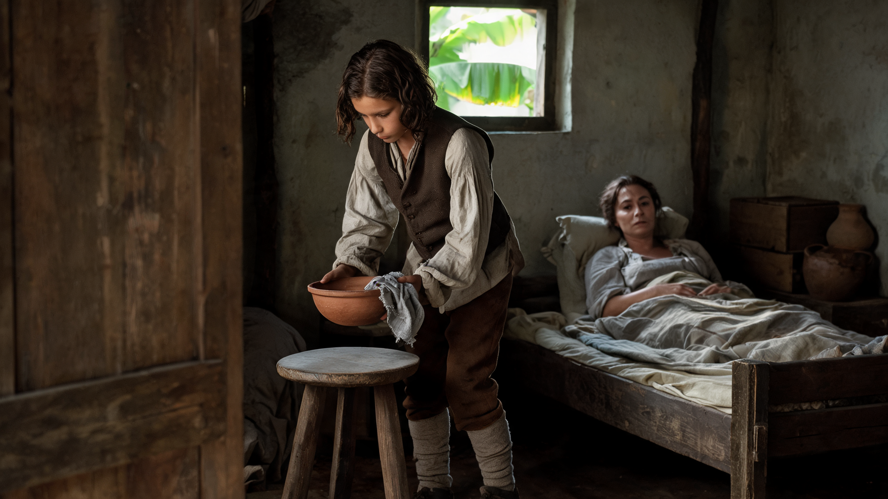

**观众看见：**狭窄的房间里，孩子把碗放到母亲床边。母亲没有回应，只有很轻的呼吸。这个动作熟练、安静，像已经重复过许多次。

**这一镜的作用：**还能够照料她。

**生成 / 取用：**12秒源片；预取源1–6秒，成片用5秒。

**摄影：**摄影机完全固定，保持首帧的侧面中景、镜头高度和景深。

**剪切：**从已经在进行的动作进入，不放标题。碗放稳、手稍停后，硬切同方向的空床画面。

**声音（后期）：**后期只铺很低的室内底声；碗触木凳一次轻响。没有可辨识的人声或喘息表演。

**API将发送的完整提示词：**

```text
12秒，单个连续镜头，横向历史实景电影画面。从输入首帧的准确状态继续，保持原有空间、人物面容与年龄、头发、衣服、道具、自然光、湿度、色彩和颗粒。摄影机完全固定，保持首帧的侧面中景、镜头高度和景深。动作按真实速度发生，光线不突然变亮；保留旧房间与物件实际使用后的磨损，不增加舞台灯、金色滤镜、油画笔触、柔光美颜或装饰性烟雾。

0–1秒：延续首帧弯身托碗的姿态，母亲仍斜靠床上。
1–4秒：孩子把现有陶碗和搭在碗沿的湿布一起缓慢落到眼前木凳上，碗底先接触凳面。
4–6秒：双手轻轻松开，停在碗旁；母亲不伸手接碗。
6–12秒：孩子安静停留，母亲只作微小自然呼吸，房间没有新的事件。

陶碗、湿布与木凳保持一一对应，不新增物件。整个片段内不切镜、不转场、不变焦、不突然拉焦、不慢动作；物件不凭空增减、穿透或变形。人物不看镜头、不作夸张表情。不出现对白、独白、配音、歌唱、口型表演、音乐、音效或字幕；输出无声。保留现有微小自然变化，不将尾段冻结为静帧。开头和结尾都不淡入淡出、不加黑场或片头片尾。
```

**验收：**母亲始终在床上，未变换身份；碗底真实落凳，手没有穿进碗里；安静停顿至少能取用1秒。

首帧：`firstframes/S01.png`；提示词：`prompts/S01.txt`。使用同账号原始图片字节，不重新压图。

### 02 · S02 空床 · 00:05–00:10

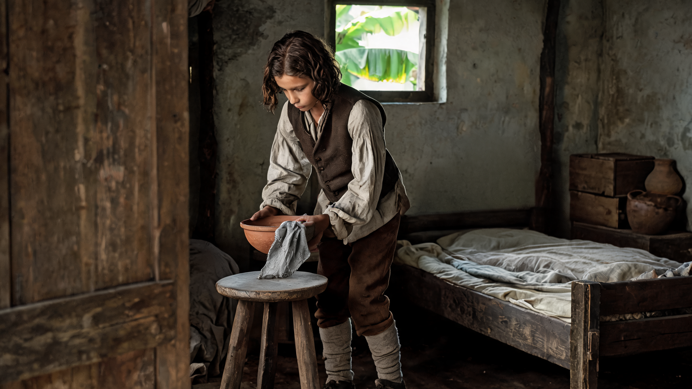

**观众看见：**几乎相同的房间里，床上已经没有母亲。切进来时孩子的手正离开碗，随后面对空床停住。观众通过缺席理解失去，不用死亡表演。

**这一镜的作用：**动作还在，接受照料的人已不在。

**生成 / 取用：**12秒源片；预取源4–9秒，成片用5秒。

**摄影：**摄影机完全固定，保持首帧构图和景深，不向空床推进。

**剪切：**取放稳后的松手与空床停顿，避免重复演示完整放碗。采用相似构图作联想剪辑，不做变形过渡；空床被看见之后直接切已长大的少年。

**声音（后期）：**沿用同一室内底声；此处碗响更轻。环境声不中断，不插悲伤音效。

**API将发送的完整提示词：**

```text
12秒，单个连续镜头，横向历史实景电影画面。从输入首帧的准确状态继续，保持原有空间、人物面容与年龄、头发、衣服、道具、自然光、湿度、色彩和颗粒。摄影机完全固定，保持首帧构图和景深，不向空床推进。动作按真实速度发生，光线不突然变亮；保留旧房间与物件实际使用后的磨损，不增加舞台灯、金色滤镜、油画笔触、柔光美颜或装饰性烟雾。

0–2秒：孩子仍托着首帧中已有的陶碗与湿布，床一直空着。
2–4秒：沿眼前最短路径将陶碗和原有湿布一起放稳在木凳面上。
4–5秒：双手松开并停在近处，湿布自然保持搭在碗沿的原状。
5–12秒：孩子目光低垂，手和身体安静停留；薄被与床铺保持空置。

右侧空床全程不出现人、人体轮廓或新隆起；不让母亲在镜头中消失。整个片段内不切镜、不转场、不变焦、不突然拉焦、不慢动作；物件不凭空增减、穿透或变形。人物不看镜头、不作夸张表情。不出现对白、独白、配音、歌唱、口型表演、音乐、音效或字幕；输出无声。保留现有微小自然变化，不将尾段冻结为静帧。开头和结尾都不淡入淡出、不加黑场或片头片尾。
```

**验收：**床全程为空；首帧持碗状态没有跳成空手；动作结束后留出明确的空床阅读时间。

首帧：`firstframes/S02.png`；提示词：`prompts/S02.txt`。使用同账号原始图片字节，不重新压图。

### 03 · S03 商行谋生 · 00:10–00:17

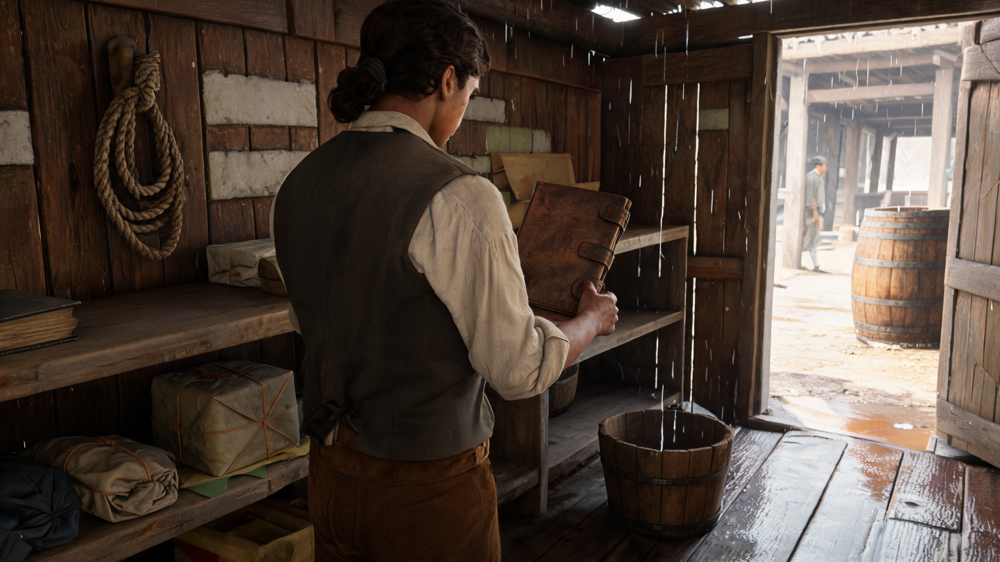

**观众看见：**时间跳过去，孩子已长成少年。在漏雨的商行，他先把账册护到干处。动作表现责任与生计，远处滴水让坏天气先从生活中出现。

**这一镜的作用：**少年已经靠劳动维持生活。

**生成 / 取用：**12秒源片；预取源1–8秒，成片用7秒。

**摄影：**摄影机完全固定，保持首帧中景、朝向和景深。

**剪切：**从孩子的手切到少年扶账册的手，身形和工作场所交代多年过去。在扶稳之后切远海，扩大风雨的空间。

**声音（后期）：**木桶接水和木架轻响；成片16.3秒起提前引入低沉风声，接17秒鸟瞰。

**API将发送的完整提示词：**

```text
12秒，单个连续镜头，横向历史实景电影画面。从输入首帧的准确状态继续，保持原有空间、人物面容与年龄、头发、衣服、道具、自然光、湿度、色彩和颗粒。摄影机完全固定，保持首帧中景、朝向和景深。动作按真实速度发生，光线不突然变亮；保留旧房间与物件实际使用后的磨损，不增加舞台灯、金色滤镜、油画笔触、柔光美颜或装饰性烟雾。

0–1秒：延续抱住近乎竖直账册的姿势。
1–5秒：少年把账册下缘缓慢落到紧邻的干燥空架面上，账册保持近乎竖直，一只手始终扶稳。
5–12秒：继续扶住账册并停顿，身体保持原朝向；原有屋顶滴水断续落入旁边的木桶。

账册不旋转放平、不翻页、不撒手；少年不转身或重新抓取。书架的干燥处保持干燥。整个片段内不切镜、不转场、不变焦、不突然拉焦、不慢动作；物件不凭空增减、穿透或变形。人物不看镜头、不作夸张表情。不出现对白、独白、配音、歌唱、口型表演、音乐、音效或字幕；输出无声。保留现有微小自然变化，不将尾段冻结为静帧。开头和结尾都不淡入淡出、不加黑场或片头片尾。
```

**验收：**账册下缘和架面真实接触；扶册手没有完全松开；成年少年与童年段有可辨识年龄差。

首帧：`firstframes/S03.png`；提示词：`prompts/S03.txt`。使用同账号原始图片字节，不重新压图。

### 04 · E01 远海雨墙 · 群岛鸟瞰 · 00:17–00:21

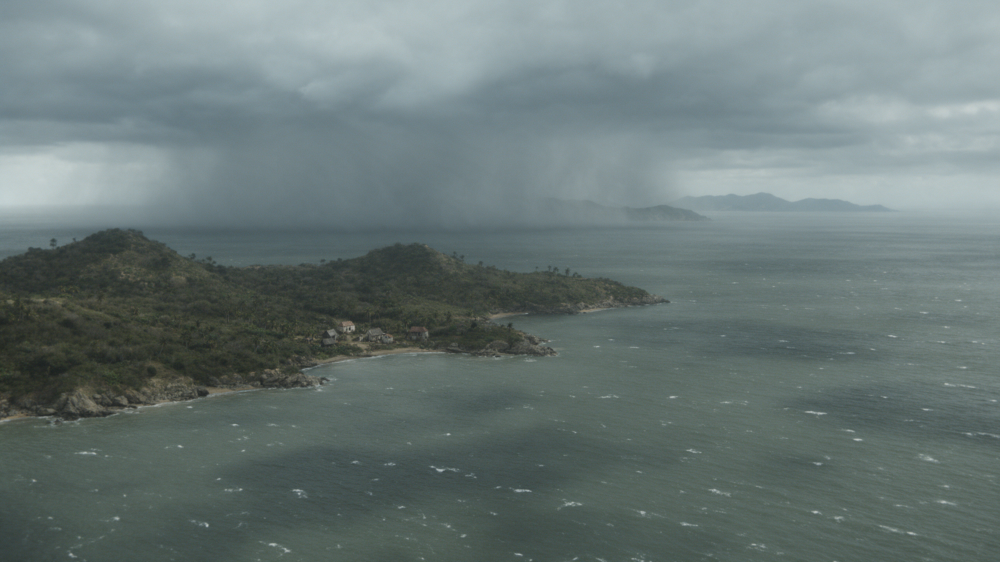

**观众看见：**从逼仄商行骤然来到远海。低岛被灰色海水围住，远处雨墙压低了能见度。画面看得很远，却不给观众游览风景的舒适感。

**这一镜的作用：**第一次看见整个岛的处境。

**生成 / 取用：**12秒源片；预取源2–6秒，成片用4秒。

**摄影：**保持首帧的鸟瞰方向、高度与俯角，仅作极慢、单一方向的小幅向前平移，12秒内画面位移很小。

**剪切：**商行硬切鸟瞰，4秒内建立尺度；随后立刻降回门廊地面，整片不再反复航拍。

**声音（后期）：**宽阔、低沉的风和远海底声，没有航拍器声。音量不冲击式拔高。

**API将发送的完整提示词：**

```text
12秒，单个连续镜头，横向历史实景电影画面。从输入首帧的准确状态继续，保持原有空间、人物面容与年龄、头发、衣服、道具、自然光、湿度、色彩和颗粒。保持首帧的鸟瞰方向、高度与俯角，仅作极慢、单一方向的小幅向前平移，12秒内画面位移很小。动作按真实速度发生，光线不突然变亮；保留旧房间与物件实际使用后的磨损，不增加舞台灯、金色滤镜、油画笔触、柔光美颜或装饰性烟雾。

0–4秒：海面原有白浪不规则地起伏，远处雨墙缓慢移动。
4–8秒：一小段远处岛脊逐渐被雨雾削弱，近岛的海岸轮廓仍保持可辨。
8–12秒：继续同一方向的极慢观察，天气自然延续，不发生新的灾难事件。

不环绕、不俯冲、不升降，不改变海岸线；不出现卫星视角、暴风眼、闪电表演或现代建筑。整个片段内不切镜、不转场、不变焦、不突然拉焦、不慢动作；物件不凭空增减、穿透或变形。人物不看镜头、不作夸张表情。不出现对白、独白、配音、歌唱、口型表演、音乐、音效或字幕；输出无声。保留现有微小自然变化，不将尾段冻结为静帧。开头和结尾都不淡入淡出、不加黑场或片头片尾。
```

**验收：**海岸线与岛屿数量稳定；移动极慢且单向，没有环绕；雨墙没有变成可见实体墙或海啸。

首帧：`firstframes/E01.png`；提示词：`prompts/E01.txt`。使用同账号原始图片字节，不重新压图。

### 05 · E03 门廊下的雨街 · 00:21–00:26

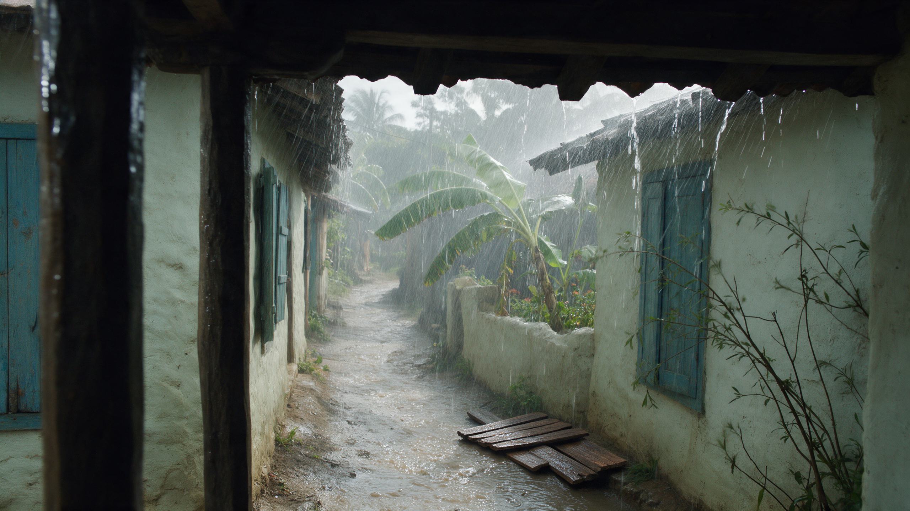

**观众看见：**黑暗的近处屋檐压在头顶，街巷被斜雨遮住。近处檐水断断续续，远处蕉叶受风。摄影机留在门廊里，任风雨发生。

**这一镜的作用：**观众站在一个能避雨的地方。

**生成 / 取用：**12秒源片；预取源2–7秒，成片用5秒。

**摄影：**摄影机完全固定在首帧门廊下，保持高度、朝向和前景屋檐的遮挡。

**剪切：**鸟瞰后硬切屋檐遮挡，观众的观看位置变得具体。斜雨持续时切少年抵窗，风声保持连续。

**声音（后期）：**近处檐水清楚、远处风声较闷；剪到室内时高频雨声被窗墙遮掉。

**API将发送的完整提示词：**

```text
12秒，单个连续镜头，横向历史实景电影画面。从输入首帧的准确状态继续，保持原有空间、人物面容与年龄、头发、衣服、道具、自然光、湿度、色彩和颗粒。摄影机完全固定在首帧门廊下，保持高度、朝向和前景屋檐的遮挡。动作按真实速度发生，光线不突然变亮；保留旧房间与物件实际使用后的磨损，不增加舞台灯、金色滤镜、油画笔触、柔光美颜或装饰性烟雾。

0–4秒：屋檐近处落水与街道斜雨以不同节奏持续，远处蕉叶朝同一受风方向伏动。
4–8秒：一阵稍密的斜雨掠过街道，泥水沿原地势流动，门窗和屋顶保持原位。
8–12秒：雨势自然回到此前强度，檐水仍断续落下。

不晃镜模拟纪实，不走出门廊，不新增人物、波纹金属板或现代路面，不发生坍塌。整个片段内不切镜、不转场、不变焦、不突然拉焦、不慢动作；物件不凭空增减、穿透或变形。人物不看镜头、不作夸张表情。不出现对白、独白、配音、歌唱、口型表演、音乐、音效或字幕；输出无声。保留现有微小自然变化，不将尾段冻结为静帧。开头和结尾都不淡入淡出、不加黑场或片头片尾。
```

**验收：**前景檐柱和街巷结构不漂移；修正后的旧木板未变回金属片；雨与蕉叶的受风方向一致。

首帧：`firstframes/E03.png`；提示词：`prompts/E03.txt`。使用同账号原始图片字节，不重新压图。

### 06 · S04 风压 · 00:26–00:33

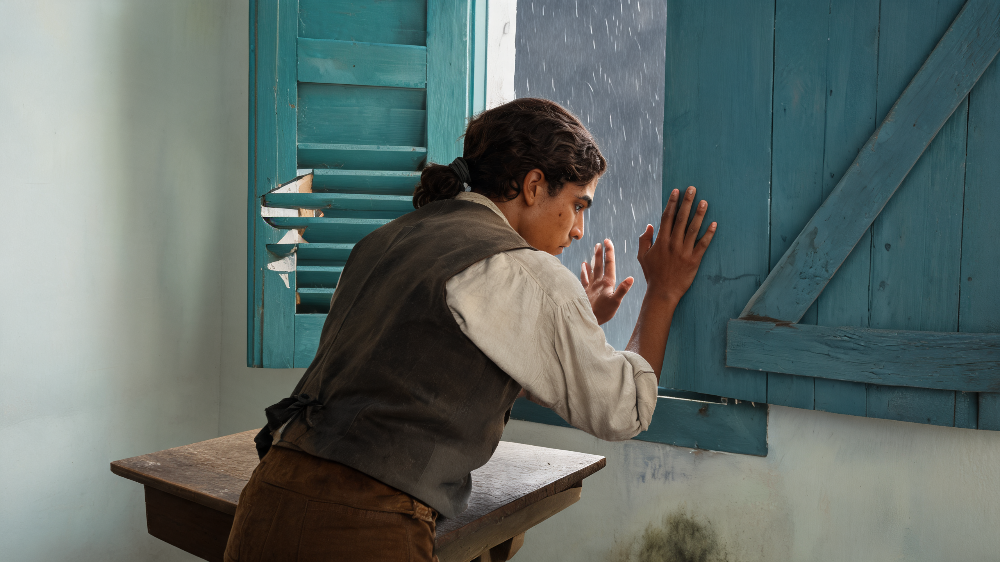

**观众看见：**回到室内，少年把还悬着的左掌补到窗板上。一阵风压让肘部稍退，他顶住。动作很小，重量来自前面的雨街和海面。

**这一镜的作用：**整场风灾落到一双手上。

**生成 / 取用：**12秒源片；预取源1–8秒，成片用7秒。

**摄影：**摄影机完全固定，保持首帧的背侧中景与景深。

**剪切：**雨街的斜雨接到窗缝；窗板受压后切缆绳与水，同一股力量从身体延伸至港口。

**声音（后期）：**木窗低哑吱声只出现一次；室内风声闷，不加入呼喊或重击配乐。

**API将发送的完整提示词：**

```text
12秒，单个连续镜头，横向历史实景电影画面。从输入首帧的准确状态继续，保持原有空间、人物面容与年龄、头发、衣服、道具、自然光、湿度、色彩和颗粒。摄影机完全固定，保持首帧的背侧中景与景深。动作按真实速度发生，光线不突然变亮；保留旧房间与物件实际使用后的磨损，不增加舞台灯、金色滤镜、油画笔触、柔光美颜或装饰性烟雾。

0–1秒：右掌持续贴住首帧中的实木窗板，左掌仍在原来的附近位置。
1–3秒：左掌向同一窗扇邻近的实木部位短距离靠近并贴稳。
3–5秒：仅一次风压让窗板、双肘和上身有微小受力变化；两只手保持接触，没有松开。
5–12秒：少年回稳并继续抵住窗板，原有窗缝的雨持续。

不把窗缝完全关死、不抬窗板、不换手、不新增脚步，不让窗户爆裂或人物被风吹飞。整个片段内不切镜、不转场、不变焦、不突然拉焦、不慢动作；物件不凭空增减、穿透或变形。人物不看镜头、不作夸张表情。不出现对白、独白、配音、歌唱、口型表演、音乐、音效或字幕；输出无声。保留现有微小自然变化，不将尾段冻结为静帧。开头和结尾都不淡入淡出、不加黑场或片头片尾。
```

**验收：**左手从悬空到贴木板的路径连贯；右掌持续接触，窗扇没有复制；一次压力后回稳，不反复弹跳。

首帧：`firstframes/S04.png`；提示词：`prompts/S04.txt`。使用同账号原始图片字节，不重新压图。

### 07 · E04 风压下的旧码头 · 00:33–00:37

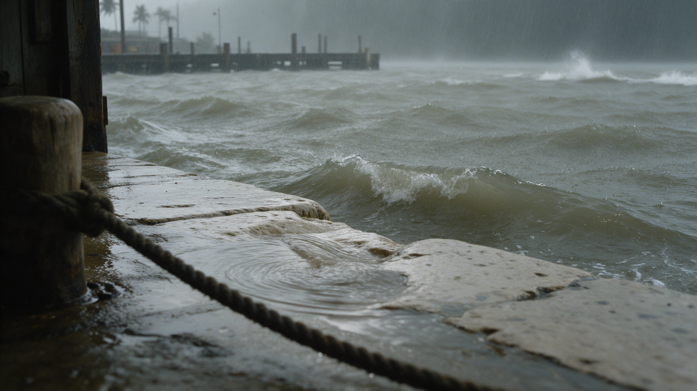

**观众看见：**低机位贴着湿石岸。浪越过边缘，缆绳绷紧，水又退去。我们看见一小块真实物件如何受力，而不是一张灾难海报。

**这一镜的作用：**房间外还有整个港口在受力。

**生成 / 取用：**12秒源片；预取源3–7秒，成片用4秒。

**摄影：**摄影机完全固定在首帧低机位，保持系缆柱、前景绳索和岸沿的构图。

**剪切：**接窗板的受力，4秒取到浪上岸及退水。37秒硬切灾后，风雨声在切点迅速收掉。

**声音（后期）：**绳索低响、一次浪水上石与回流；切灾后时只保留约0.25秒退水尾声。

**API将发送的完整提示词：**

```text
12秒，单个连续镜头，横向历史实景电影画面。从输入首帧的准确状态继续，保持原有空间、人物面容与年龄、头发、衣服、道具、自然光、湿度、色彩和颗粒。摄影机完全固定在首帧低机位，保持系缆柱、前景绳索和岸沿的构图。动作按真实速度发生，光线不突然变亮；保留旧房间与物件实际使用后的磨损，不增加舞台灯、金色滤镜、油画笔触、柔光美颜或装饰性烟雾。

0–3秒：原有近岸水面起伏，一次普通风浪逐渐接近石岸。
3–5秒：这一小股浪水越过岸沿，已有缆绳只轻微绷紧。
5–7秒：水沿石面自然退回，缆绳压力稍缓。
7–12秒：继续不规则的小幅水面起伏，不再安排第二次显著冲击。

不生成巨浪、海啸、船只撞击或断绳，不增加轮胎、现代防波设施或人物。整个片段内不切镜、不转场、不变焦、不突然拉焦、不慢动作；物件不凭空增减、穿透或变形。人物不看镜头、不作夸张表情。不出现对白、独白、配音、歌唱、口型表演、音乐、音效或字幕；输出无声。保留现有微小自然变化，不将尾段冻结为静帧。开头和结尾都不淡入淡出、不加黑场或片头片尾。
```

**验收：**浪的尺度普通且与岸沿一致；水真实流回海里；绳索与系缆柱连接不变，没有重复冲击。

首帧：`firstframes/E04.png`；提示词：`prompts/E04.txt`。使用同账号原始图片字节，不重新压图。

### 08 · E05 雨停后的街巷 · 00:37–00:42

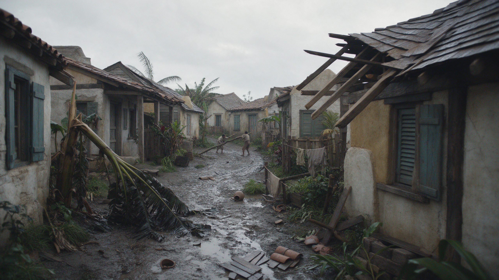

**观众看见：**同一类港镇街巷已经安静。有人家的屋顶坏了一角，有人家仍能住。远处两个人扶着木料，近处泥水和倒伏的树占据画面。没有人为镜头表演悲惨。

**这一镜的作用：**灾难结束，生活留下损失。

**生成 / 取用：**12秒源片；预取源2–7秒，成片用5秒。

**摄影：**摄影机完全固定在当前地面视角，保持全景、遮挡和景深。

**剪切：**用风声的骤退标明时间跳跃，不做渐变天气。安静停留5秒后切桌前，窗光自然变亮但不变暖金。

**声音（后期）：**稀疏滴水、很远的木料轻碰；41.5秒提前入下一镜的室内底声与滴水，笔尖摩擦只对齐S05实际可见的收笔。

**API将发送的完整提示词：**

```text
12秒，单个连续镜头，横向历史实景电影画面。从输入首帧的准确状态继续，保持原有空间、人物面容与年龄、头发、衣服、道具、自然光、湿度、色彩和颗粒。摄影机完全固定在当前地面视角，保持全景、遮挡和景深。动作按真实速度发生，光线不突然变亮；保留旧房间与物件实际使用后的磨损，不增加舞台灯、金色滤镜、油画笔触、柔光美颜或装饰性烟雾。

0–4秒：灰阴的灾后白昼，屋檐偶尔滴水，地面积水有很小的自然波纹。
4–8秒：极远处原有的两个人只略微调整握力，稳住他们已经扶着的同一根木料；身体位置变化极小。
8–12秒：他们继续扶稳木料，街巷安静，偶有滴水，不出现新的事件。

不安排完整搬运动作、不新增人群、不继续坍塌，不让雨停后立刻出现金色阳光或英雄姿态。整个片段内不切镜、不转场、不变焦、不突然拉焦、不慢动作；物件不凭空增减、穿透或变形。人物不看镜头、不作夸张表情。不出现对白、独白、配音、歌唱、口型表演、音乐、音效或字幕；输出无声。保留现有微小自然变化，不将尾段冻结为静帧。开头和结尾都不淡入淡出、不加黑场或片头片尾。
```

**验收：**房屋破损程度维持原图，不全部夷平；远处两人和木料数量、位置稳定；灾后没有恢复为暴雨镜头。

首帧：`firstframes/E05.png`；提示词：`prompts/E05.txt`。使用同账号原始图片字节，不重新压图。

### 09 · S05 自己的文字 · 00:42–00:49

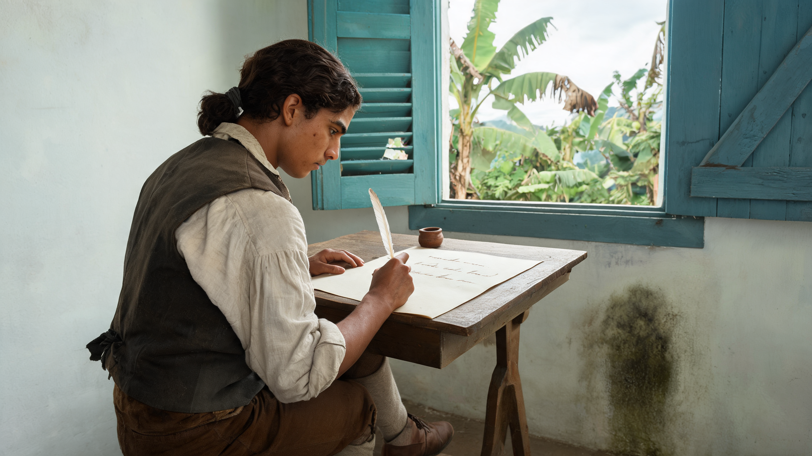

**观众看见：**纸上已经有几行细小笔迹。少年只把最后一点笔势收住，抬笔，停看。我们关注他写完之后的停顿，文字不承担需要读懂的内容。

**这一镜的作用：**他把经历变成了文字。

**生成 / 取用：**12秒源片；预取源1–8秒，成片用7秒。

**摄影：**摄影机完全固定，保持首帧桌边背侧中近景，不靠近纸面、不拉焦到字。

**剪切：**从灾后的环境后果切入写完的纸。目光停住后切另一个人阅读，建立文章被看见的关系。

**声音（后期）：**只在收笔处一点笔尖摩擦，之后是安静室内底声；没有把文字念出来的声音。

**API将发送的完整提示词：**

```text
12秒，单个连续镜头，横向历史实景电影画面。从输入首帧的准确状态继续，保持原有空间、人物面容与年龄、头发、衣服、道具、自然光、湿度、色彩和颗粒。摄影机完全固定，保持首帧桌边背侧中近景，不靠近纸面、不拉焦到字。动作按真实速度发生，光线不突然变亮；保留旧房间与物件实际使用后的磨损，不增加舞台灯、金色滤镜、油画笔触、柔光美颜或装饰性烟雾。

0–1秒：延续首帧握笔与左手压纸的准确姿势，纸面已有笔迹保持原样。
1–2秒：右手只作一次极短的收笔，笔尖位置保持在原有局部遮挡附近，不写出新的单词或整行。
2–3秒：笔尖稍稍离开纸面。
3–12秒：少年安静看着纸，左手继续压住同一纸角；纸、墨罐和桌面都不移动。

不从白纸开始写字、不出现粗杠、不增加滚动字符、不蘸墨、不翻页，不试图展示可辨读的英文句子。整个片段内不切镜、不转场、不变焦、不突然拉焦、不慢动作；物件不凭空增减、穿透或变形。人物不看镜头、不作夸张表情。不出现对白、独白、配音、歌唱、口型表演、音乐、音效或字幕；输出无声。保留现有微小自然变化，不将尾段冻结为静帧。开头和结尾都不淡入淡出、不加黑场或片头片尾。
```

**验收：**已有细字不变成爬动符号或粗线；只收笔一次，随后笔尖离纸；脸、手、纸与墨罐不漂移。

首帧：`firstframes/S05.png`；提示词：`prompts/S05.txt`。使用同账号原始图片字节，不重新压图。

### 10 · S06 文章获得支持 · 00:49–00:59

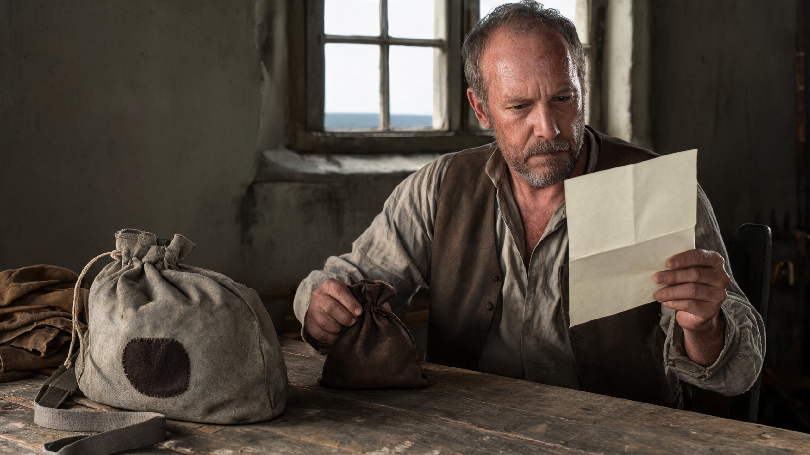

**观众看见：**一个成年读者继续看信。他没有开口，也没有抬头赞许，只把桌上的钱袋推到旅行袋旁。纸与路费在同一个画面里，支持因此变得具体。

**这一镜的作用：**有人愿意让他离开这里。

**生成 / 取用：**15秒源片；预取源2–12秒，成片用10秒。

**摄影：**摄影机完全固定，保持首帧读者、钱袋与旅行袋同时可见的构图和景深。

**剪切：**纸的阅读接住上一镜写作；钱袋推近旅行袋后再停留。59秒直接切少年身上的单只补丁袋与舷梯。

**声音（后期）：**轻微纸响、布袋擦木面；57.8秒先入平静港口水声，预告离岛。

**API将发送的完整提示词：**

```text
15秒，单个连续镜头，横向历史实景电影画面。从输入首帧的准确状态继续，保持原有空间、人物面容与年龄、头发、衣服、道具、自然光、湿度、色彩和颗粒。摄影机完全固定，保持首帧读者、钱袋与旅行袋同时可见的构图和景深。动作按真实速度发生，光线不突然变亮；保留旧房间与物件实际使用后的磨损，不增加舞台灯、金色滤镜、油画笔触、柔光美颜或装饰性烟雾。

0–4秒：读者左手一直拿着原有信纸，空白背面朝摄影机，安静阅读；右手仍握着桌上的原有钱袋。
4–7秒：右手把钱袋沿桌面向画面左侧的旅行袋旁缓慢滑动一小段，袋底全程接触桌面。
7–9秒：右手放松手指并停住，左手保持持信。
9–15秒：钱袋留在靠近旅行袋的位置，读者继续看纸，保持安静。

不翻信纸、不放信纸、不新增钱袋或散落金币，不开合旅行袋，不让其他人物进入。整个片段内不切镜、不转场、不变焦、不突然拉焦、不慢动作；物件不凭空增减、穿透或变形。人物不看镜头、不作夸张表情。不出现对白、独白、配音、歌唱、口型表演、音乐、音效或字幕；输出无声。保留现有微小自然变化，不将尾段冻结为静帧。开头和结尾都不淡入淡出、不加黑场或片头片尾。
```

**验收：**左手持纸始终不换手、不放下；钱袋沿桌面短移，不提起掉落；钱袋与旅行袋全程各一只。

首帧：`firstframes/S06.png`；提示词：`prompts/S06.txt`。使用同账号原始图片字节，不重新压图。

### 11 · S07 登船离开 · 00:59–01:08

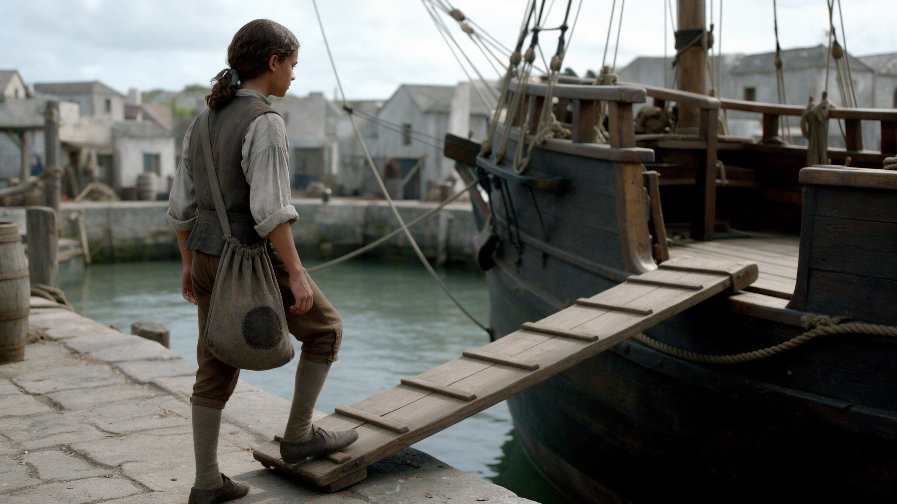

**观众看见：**少年背着那一只灰布袋，继续沿木梯上船。摄影机留在岸上。他被船舷开口遮住之后，空梯子和水还在。最后一点等待交给第一幕。

**这一镜的作用：**他走出了画面，未来留在画外。

**生成 / 取用：**15秒源片；预取源2–11秒，成片用9秒。

**摄影：**摄影机完全固定在首帧岸上背侧视角，不跟拍、不推进、不向天空抬镜。

**剪切：**从钱袋旁的旅行袋接到少年携带的布袋，采用道具联想而非袋子特写变形。取到人物离画后约3秒空梯。成片最后12帧由剪辑淡黑，68秒交给第一幕入口。

**声音（后期）：**几次克制的木板脚步与平静水声；人离画后脚步消失，最后0.5秒水声随画面退去。

**API将发送的完整提示词：**

```text
15秒，单个连续镜头，横向历史实景电影画面。从输入首帧的准确状态继续，保持原有空间、人物面容与年龄、头发、衣服、道具、自然光、湿度、色彩和颗粒。摄影机完全固定在首帧岸上背侧视角，不跟拍、不推进、不向天空抬镜。动作按真实速度发生，光线不突然变亮；保留旧房间与物件实际使用后的磨损，不增加舞台灯、金色滤镜、油画笔触、柔光美颜或装饰性烟雾。

0–1秒：从首帧已有一只脚踩上舷梯的状态继续，重心自然移向这一脚。
1–8秒：少年以正常而从容的步伐沿现有木舷梯上行，进入原有船舷开口；每一步脚底接触木板，单只旅行袋随步伐小幅摆动。到8秒左右，身体被船舷和开口自然遮住，离开视野。
8–15秒：保持空舷梯与原船体构图，水面仍有微小流动，少年不重新出现。

不增加第二件行李、不更改肩带与补丁，不回头、不跳跃，不加人，不让人物融化或瞬移，不使船、岸或梯子移动。整个片段内不切镜、不转场、不变焦、不突然拉焦、不慢动作；物件不凭空增减、穿透或变形。人物不看镜头、不作夸张表情。不出现对白、独白、配音、歌唱、口型表演、音乐、音效或字幕；输出无声。保留现有微小自然变化，不将尾段冻结为静帧。开头和结尾都不淡入淡出、不加黑场或片头片尾。
```

**验收：**每步落在原木梯上，人物被船体遮挡后离画；只保留一只灰色补丁旅行袋；可用段末尾至少2秒空梯，没有模型自动黑场。

首帧：`firstframes/S07.png`；提示词：`prompts/S07.txt`。使用同账号原始图片字节，不重新压图。

## 整片剪辑与声音

按24fps规划，成片1632帧。镜间全部硬切，不使用溶解、变形转场或数字推拉。S01→S02是相似构图下的时间跳跃；S02→S03以年龄和工作空间明确经过多年；风暴在商行段之后出现。

37秒码头切灾后，以风雨声骤退建立另一时段；42秒进入写作。59秒旅行袋接登船，同款道具建立因果，不做照片间的精确形状变换。成片最后12帧在剪辑端淡黑，生成片段本身不带黑场。68秒后由现有第一幕流程接入，不额外堆叠字幕或片头。此轮不修改游戏播放入口。

所有AI视频直接关闭音轨。后期只计划人工选择或录制的室内底声、滴水、风、浪、木件、笔纸和脚步，没有任何对白、独白、AI配音、歌声或配乐。声音表是待制作的声音脚本，本包没有伪装成已制作的音效。

后期先核对720p源片实际时长、尺寸、帧率、是否含音轨与编码。保留模型原文件，如播放器兼容有问题，再另做播放副本，不把播放器解码问题算成生成失败。调色只做镜间曝光与白平衡衔接，不磨皮、不增金色、不重新烘焙文字。

## 两张替换备选

**E02 海湾压雨 · 近岸鸟瞰 → 仅可替换E01。**不计入本批提交。

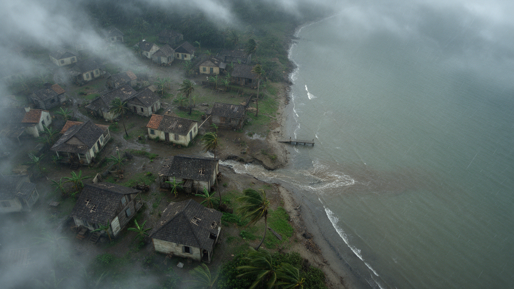

**E06 被压倒的甘蔗地 → 仅可替换E05。**不计入本批提交。

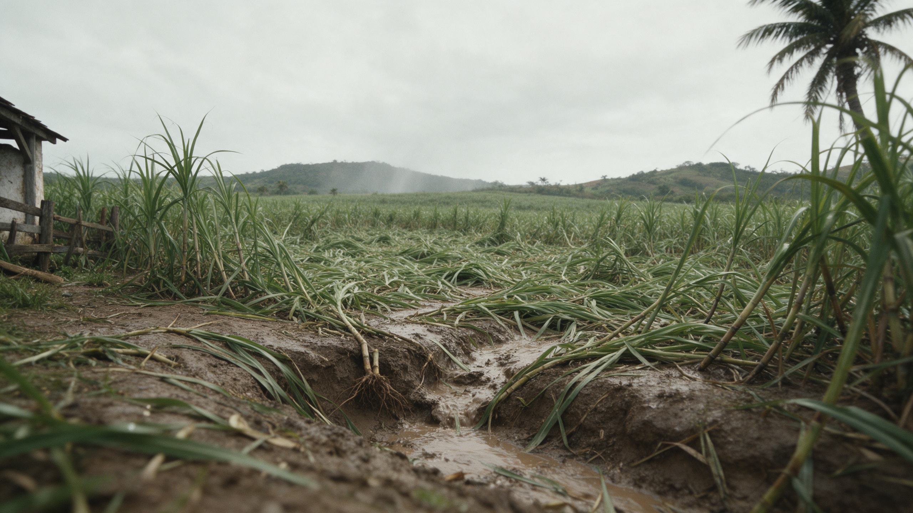

## 我接下来如何执行

你明确说“按v6开始生成”后，我先核对当前审阅指纹、费用有效期与原图，然后用现有本机Key顺序完成11镜的创建、查询和下载。你不需要复制提示词、上传首帧、运行代码或逐条下载。更改画质或镜头需要更新同一份计划并重新生成审阅指纹。

后端默认不发请求。正式生成每次只处理一镜，完成下载再继续下一镜；这不是试拍流程，期间不逐镜向你确认。遇到输入审核拒绝、余额错误或任务失败，保存结果并停在该镜；遇到提交超时则保留未知状态，不猜测失败后重复付费。已有成功任务断点续用。

当前准备状态与实际只读验证见[准备与验证记录](准备与验证记录.md)；程序操作见[后端说明](后端说明.md)。API支持关闭声音，与某些平台包装工具默认总生成声音的行为不同。

数据链：原始首帧 + 当前提示词 → 审阅指纹 → 你明确下令 → 方舟任务ID → 本地源视频与用量记录 → 逐镜验收 → 按68秒时间线剪辑、声音和第一幕衔接。
