# 离岛以前 · 两条视频实验版 v7

**保留v6；本版只准备A01人物主线30秒与B01环境20秒。720p，16:9，无声，视频预估合计¥75.60。尚未提交视频。**

这版检验模型能否在同一段视频中维持人物身份、按指定顺序切镜，并保住空景与关键动作。两条源视频由模型各自完成内部切镜；之后只需把它们按下表交叉排列，得到约50秒开场CG。不是把30秒人物片和20秒环境片直接首尾拼接。

## 压缩后的故事

床边照料只留3秒。硬切另一时刻的无人房间：窗与凳子都空着，停2秒就走。少年在商行扶稳账册，风暴才进入岛的全景：远海、海湾、檐下街道，接到少年抵窗，再切石岸和缆绳。

风雨停了，破损街巷与倒伏甘蔗交代后果。少年只收一次笔；读者先读，再把钱袋推向行李；少年上船，最后留下2秒空梯。全片不出现对白、独白、AI配音、字幕或配乐。

## 这版怎样使用参考图

原来的一镜一首帧改为多图参考模式。A01上传7张，B01上传6张；图片编号在每条请求内从1重新开始，使用官方指南的`@图片1`写法。每张图的用途和对应时间都在提示词里固定。API使用`role: reference_image`及`omni_reference_task_type: reference`，不混入`first_frame`。

**无人空景参考已单独补制。**A01的@图片2使用新N02原图，房间里没有人物，木凳上没有碗或湿布；保留旧房间、窗、床和木凳的空间关系。目标视频第3–5秒从第一帧起就无人，不能从前一镜带入人或表演人物消失。

多参考图能指导人物、场景与构图，不能把每个切点、每张图都当成已经精确锁定的首帧。下方秒数是模型需要遵守的生成脚本，生成后仍要实测。

## A01 · 人物叙事 · 7镜30秒

生成规格：30秒 / 720p / 16:9 / 无声 / 7张参考图。预计¥45.36。

| 源片时间 | 场景 | 图片 | 要完成的事 |
| --- | --- | --- | --- |
| 00–03秒 | 照料 | @图片1 | 孩子把碗放到仍在床上的母亲身边。 |
| 03–05秒 | 无人空窗与空凳 | @图片2 | 另一时刻，房间已无人；空窗和空凳只停留2秒。 |
| 05–09秒 | 商行劳动 | @图片3 | 多年后，少年在漏雨商行护住账册。 |
| 09–13秒 | 抵住风压 | @图片4 | 少年用手和身体承受一次窗板的风压。 |
| 13–17秒 | 收笔 | @图片5 | 风灾之后，纸上已有文字；少年收笔并停看。 |
| 17–23秒 | 读者资助 | @图片6 | 读者先阅读，再把钱袋推向旅行袋。 |
| 23–30秒 | 登船与空梯 | @图片7 | 少年上船离开，摄影机留在岸边看空梯。 |

### 实际上传的参考图

**@图片1 · S01** — 供对应场景、人物及道具参考。

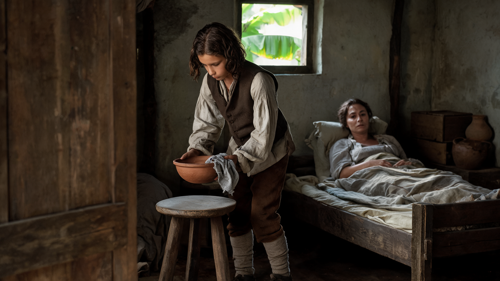

**@图片2 · N02** — 新补制的无人空窗、空凳参考。

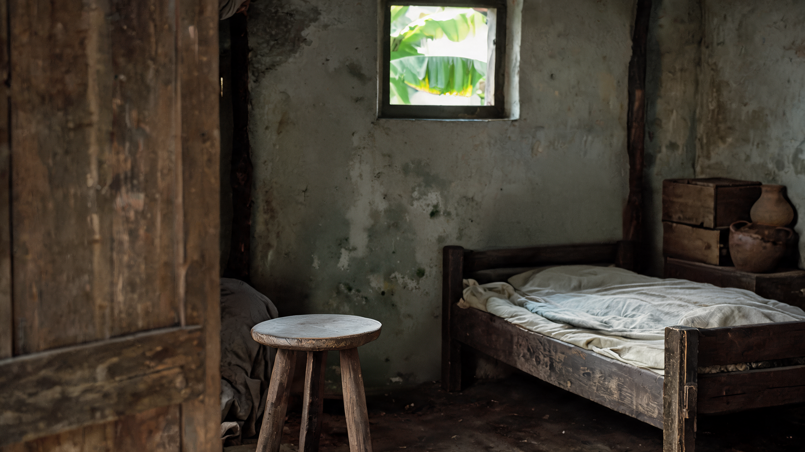

**@图片3 · S03** — 供对应场景、人物及道具参考。

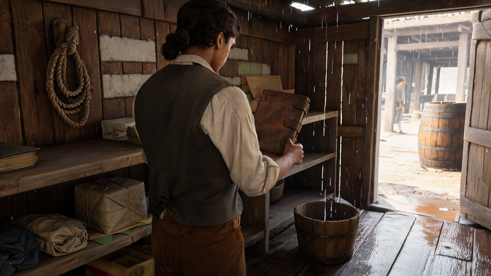

**@图片4 · S04** — 供对应场景、人物及道具参考。

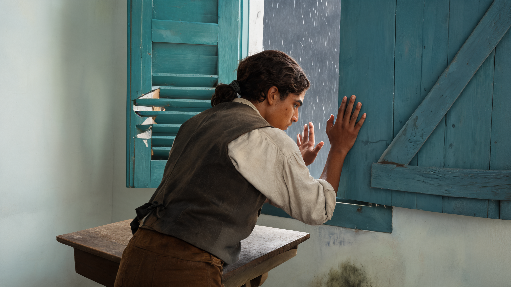

**@图片5 · S05** — 供对应场景、人物及道具参考。

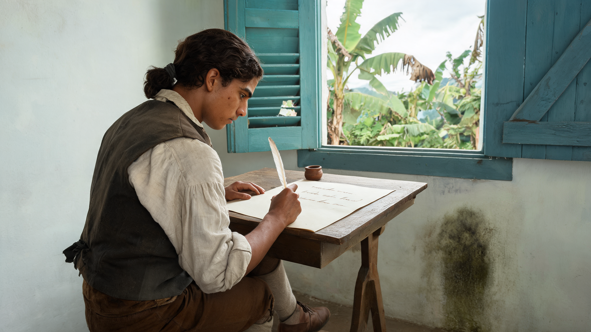

**@图片6 · S06** — 供对应场景、人物及道具参考。

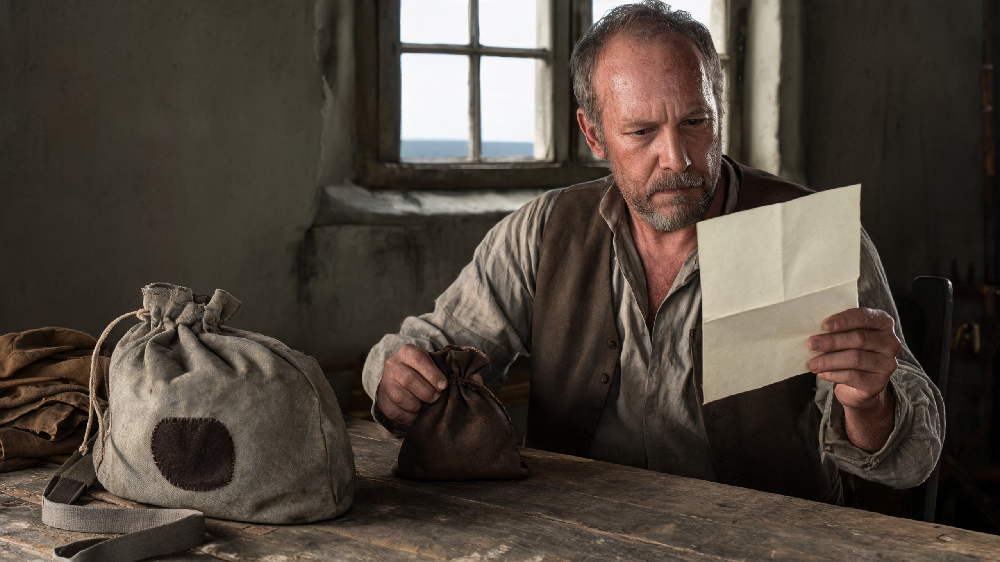

**@图片7 · S07** — 供对应场景、人物及道具参考。

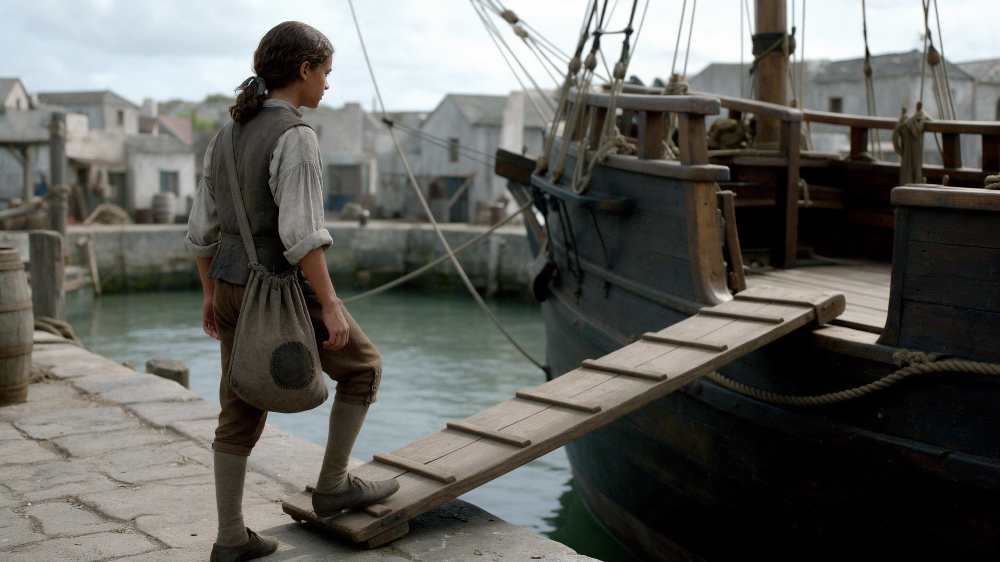

### API将发送的完整提示词

```text
生成一条30秒、包含7个明确独立镜头的历史实景电影叙事片段，18世纪加勒比海港镇。按下面的时间轴硬切各场景；每段都是真实动态镜头，不是静态图片幻灯片。人物表演克制，使用自然光、真实磨损的房间和衣料，保留参考图的湿度、颗粒与摄影质感。

输入图片按上传顺序对应：
@图片1：童年孩子照料母亲，锁定童年脸、头发、衣服及床边空间。
@图片2：已补制的无人房间参考，锁定木窗、空床和凳面无物的木凳。第3–5秒从第一帧起就保持无人空景，不带入其他图片的人与道具。
@图片3：已长大的少年在商行，锁定少年身份、低束深发、旧灰白衬衫与深色背心。
@图片4：同一少年抵窗，锁定雨中窗扇、手掌当前接触状态。
@图片5：同一少年雨后桌边收笔，锁定纸上已有细字、手、笔和陶墨罐。
@图片6：另一位五十余岁成年读者及信、钱袋、旅行袋；不是主角，不借他的脸给少年。
@图片7：同一少年携单只灰色补丁布袋登船，锁定岸、梯与船的实际连接。

身份关系：@图片1是主角童年；@图片3、4、5、7是主角少年；@图片6是不同的成年读者。每段以该段指定图片为主要场景和构图参考，角色只在指定场景出现。

逐镜时间轴（秒数为整条视频的时间，不是每镜重新从0开始）：

镜头1｜00–03秒｜照料｜场景参考@图片1
沿用床边侧面中景，固定机位。
从@图片1孩子已经弯腰托碗的状态开始。前约2秒把碗和原有湿布一起沿最短路径放到木凳，接触凳面后才松手；余下时间稍停。母亲一直斜靠床上，只保留轻微呼吸，不伸手接碗。

镜头2｜03–05秒｜无人空窗与空凳｜场景参考@图片2
固定机位，空窗和空凳同时可见。
在第3秒明确硬切到@图片2的无人房间，这是另一个时刻。镜头一开始就已经无人：只看空窗、凳面完全空着的木凳及原有房间，窗外叶子极轻微地动。全程没有主角、母亲、身体、倒影、陶碗或湿布。不从@图片1带入人物或手持物，不演人消失，也不让上一镜的人走出画面来完成转场。第5秒直接切走。

镜头3｜05–09秒｜商行劳动｜场景参考@图片3
商行侧面中景，固定机位。
第5秒硬切到@图片3。孩子已经长成该图中的瘦削少年，年龄变化只发生在切镜之间。少年将怀里近乎竖直的账册下缘落到邻近干燥架面，一手一直扶稳，然后停住。原有滴水落入木桶。账册不放平、不翻页，少年不转身。

镜头4｜09–13秒｜抵住风压｜场景参考@图片4
窗边背侧中景，固定机位。
第9秒硬切到@图片4的风雨中窗边。同一少年右掌已经贴着实木窗板，左掌还在附近。左手只短距离补到邻近实木处，两手贴稳后承受一次很小的风压：肘部和上身微微后让、再回稳。窗缝继续进雨。没有新增脚步，不关死整个窗缝，不让窗户爆裂。

镜头5｜13–17秒｜收笔｜场景参考@图片5
桌边背侧中近景，固定机位，纸面不做特写。
第13秒硬切到@图片5，明确是雨停后的另一个白昼，窗外已没有暴雨。纸上原有几行细笔迹保留。少年只做一次极短收笔，稍抬笔尖，然后安静看纸约2秒。左手一直压纸角。不从白纸写起，不新增词句、整行或粗杠，不蘸墨、不翻页。

镜头6｜17–23秒｜读者资助｜场景参考@图片6
读者、信纸、钱袋与旅行袋同框，固定中景。
第17秒硬切到@图片6的另一间屋。画中人是五十余岁的成年读者，与少年是两个不同的人。前2秒继续阅读左手中的信，空白纸背朝镜头；随后2秒用右手把原本已在桌上的钱袋向画面左侧旅行袋旁短推，袋底全程贴桌；最后2秒松指并停住。左手始终持纸，不放纸、不翻面。只有原有一个钱袋与一个旅行袋，不掉金币。

镜头7｜23–30秒｜登船与空梯｜场景参考@图片7
沿用岸上背侧全身视角，固定机位，不跟拍。
第23秒硬切到@图片7的港口。同一位少年只背一只灰色深补丁布袋，一脚已在现有木舷梯上。他用正常、从容步伐继续沿原梯走入现有船舷开口，每步脚底真实落板。登上甲板后继续沿现有甲板向画面右侧走出边界，最迟第28秒完全离画；第28–30秒保持至少2秒空梯与微动水面。不让低船舷遮住整个身体，也不新增遮挡物。不回头、不跑步、不新增行李，不瞬移或融化。船、岸、梯保持原位。

必须保留第3–5秒整整2秒无人空窗空凳；必须保留读者先读信、后推钱袋的顺序；最后至少2秒是无人空舷梯。不要遗漏任一场景或用复杂额外动作占用这些时间。时间与年龄的跨度都用明确硬切表达，不在连续镜头里把人变没、变老或换脸。

统一拍摄与声音要求：只在上述时间点切镜，镜头内部不新增剪切、环绕、甩镜、快速推进、拉焦或慢动作。所有动作按正常速度，不用慢动作填满时长。保持人物和物件结构、真实接触及自然环境变化；不加舞台聚光、金色滤镜、美颜或油画笔触。全片无对白、独白、配音、歌唱、口型表演、字幕、画内标题、音乐及音效，直接输出无声视频。参考图的@编号和本时间轴文字不进入画面。片头片尾不淡黑，不自动添加转场装饰或黑场。
```

## B01 · 风暴与灾后 · 6镜20秒

生成规格：20秒 / 720p / 16:9 / 无声 / 6张参考图。预计¥30.24。

| 源片时间 | 场景 | 图片 | 要完成的事 |
| --- | --- | --- | --- |
| 00–04秒 | 远海群岛与雨墙 | @图片1 | 远海尺度：岛很低，雨墙覆盖很大。 |
| 04–07秒 | 海湾里的居民点 | @图片2 | 从大范围岛屿切近到海湾，说明那里有人生活。 |
| 07–11秒 | 门廊下的雨街 | @图片3 | 地面尺度：摄影机躲在屋檐下，看雨横过街巷。 |
| 11–14秒 | 石岸与缆绳 | @图片4 | 港口尺度：一股浪水冲上湿石岸，又退回去。 |
| 14–17秒 | 灾后街巷 | @图片5 | 时间跳到雨后：破损不均的房屋、积水和远处清理者。 |
| 17–20秒 | 倒伏甘蔗与泥水 | @图片6 | 灾后延伸到生计：沟水流过，作物倒伏在地。 |

### 实际上传的参考图

**@图片1 · E01** — 供对应场景、人物及道具参考。

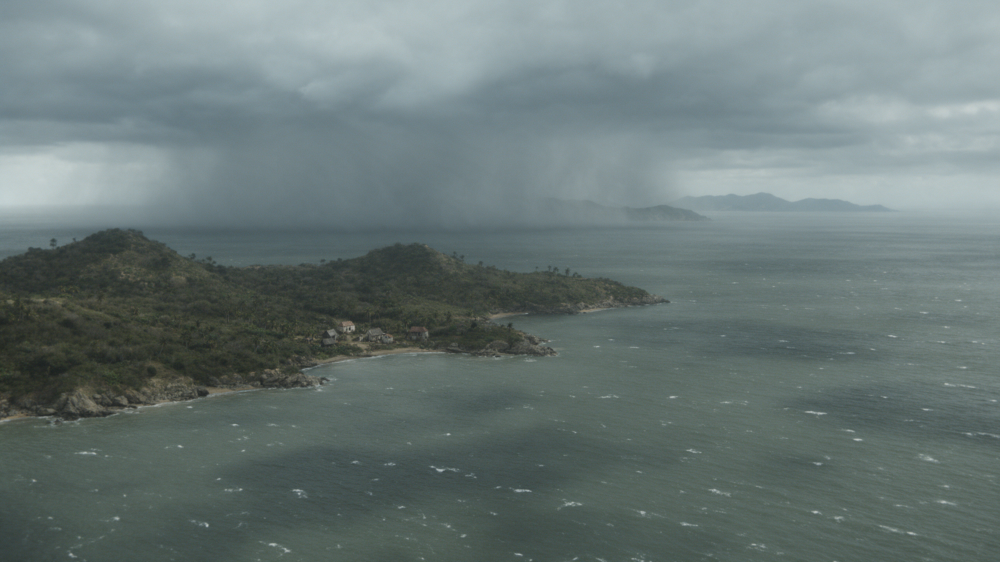

**@图片2 · E02** — 供对应场景、人物及道具参考。

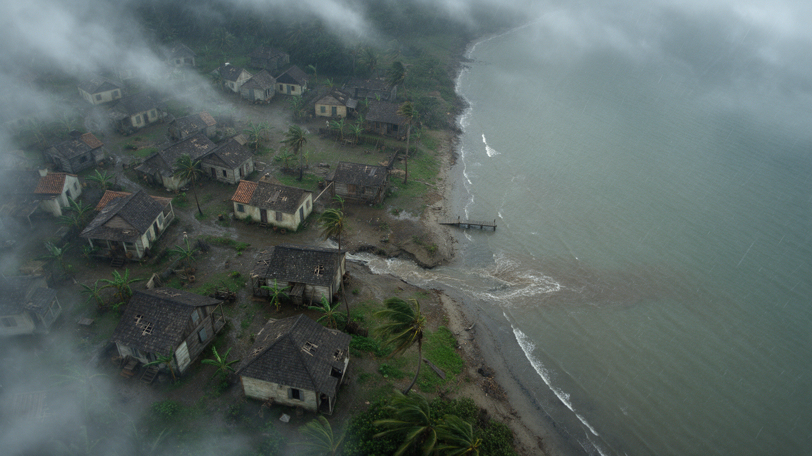

**@图片3 · E03** — 供对应场景、人物及道具参考。

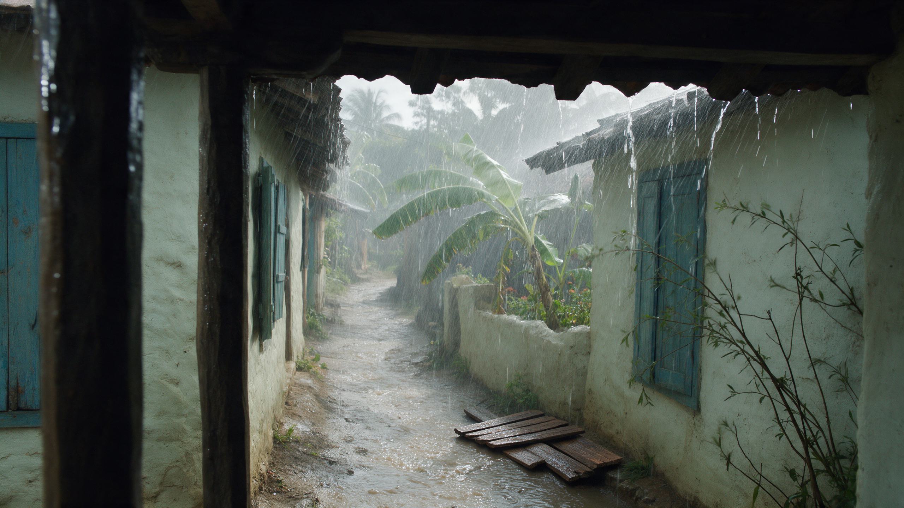

**@图片4 · E04** — 供对应场景、人物及道具参考。

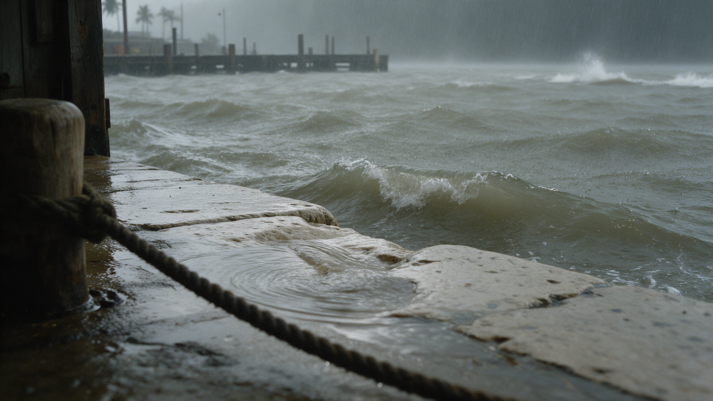

**@图片5 · E05** — 供对应场景、人物及道具参考。

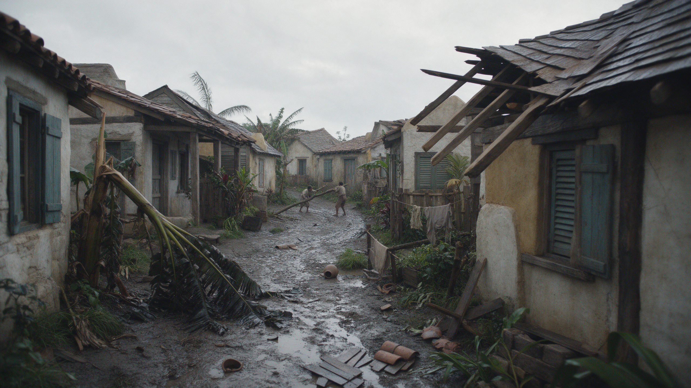

**@图片6 · E06** — 供对应场景、人物及道具参考。

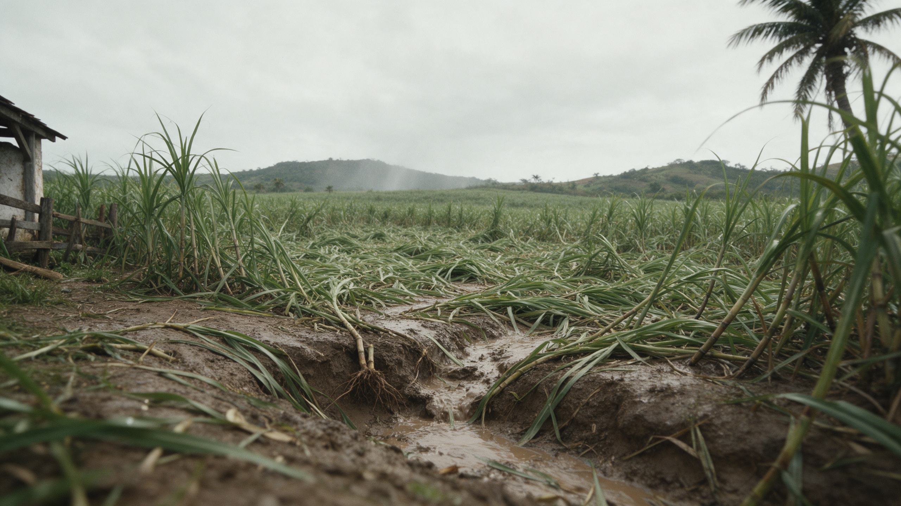

### API将发送的完整提示词

```text
生成一条20秒、包含6个明确独立镜头的18世纪加勒比环境电影片段。由远海雨墙、近岸居民点、地面雨街、受力码头，切到风灾后的街道与甘蔗地。按下面的时间点硬切；这是一组运动真实的环境镜头，不是图片溶解或自动巡游风景。保持湿灰自然光、旧木与石灰墙、泥地、热带植被和真实风雨的尺度。

输入图片按上传顺序对应：
@图片1：远海群岛与雨墙，仅用于第0–4秒。
@图片2：海湾居民点，仅用于第4–7秒。
@图片3：门廊下雨街及右下旧木板，仅用于第7–11秒。
@图片4：湿石岸、系缆柱与绳，仅用于第11–14秒。
@图片5：雨后受损街巷及极远处两名清理者，仅用于第14–17秒。
@图片6：雨后倒伏甘蔗和泥水沟，仅用于第17–20秒。

前四镜是同一次风灾中的环境；后两镜是风雨已停后的另一个白昼。保持参考图的海岸、房屋与作物特征。不能把不同图片插值变形成同一个地方；地点变化用硬切交代。

逐镜时间轴（秒数为整条视频的时间，不是每镜重新从0开始）：

镜头1｜00–04秒｜远海群岛与雨墙｜场景参考@图片1
鸟瞰方向和高度保持，只有极慢单向小幅前移。
依据@图片1，低岛与远处岛脊处于同一灰湿透视。海面白浪自然起伏，远处雨墙缓慢削弱岛脊能见度。保持海岸形状，没有卫星视角、暴风眼、俯冲或闪电表演。

镜头2｜04–07秒｜海湾里的居民点｜场景参考@图片2
更近的海湾俯视全景，机位稳定，不改变高度。
第4秒硬切到@图片2所示更近的海湾视角，不用飞行俯冲或变焦过渡。灰雨掠过海岸居民点，植物顺着风小幅伏动，水面有自然细浪。保持房屋位置、海岸线与低能见度。

镜头3｜07–11秒｜门廊下的雨街｜场景参考@图片3
地面门廊下固定全景，保留近檐与柱子的遮挡。
第7秒硬切到@图片3。近处檐水断续落下，街中斜雨掠过，远处蕉叶同向伏动，三者速度和节奏自然有别。保持右下旧木板，不出现波纹金属片。摄影机留在檐下，不走出门廊、不摇晃。

镜头4｜11–14秒｜石岸与缆绳｜场景参考@图片4
贴近湿石岸的固定低机位，原缆绳与柱子都在画面中。
第11秒硬切到@图片4，普通小浪已经接近岸沿。用这3秒完成一次小股水越过岸沿并自然回流，原有缆绳只有很小的受力变化。岸石不融化，绳柱连接不变，不明显收短绳长。没有巨浪、断绳、新船或撞击。

镜头5｜14–17秒｜灾后街巷｜场景参考@图片5
地面街巷全景，固定机位。
第14秒硬切到@图片5，明确是风雨已停后的另一个白昼。屋檐偶尔滴水，破损房屋与倒伏植株保持原状。远处原有两人只略微扶稳同一根木料，人物很小，不作完整搬运，也不出现更多人。画面安静，不继续倒屋，不突然出现金色阳光。

镜头6｜17–20秒｜倒伏甘蔗与泥水｜场景参考@图片6
甘蔗田边低处固定全景，泥水沟在前景。
第17秒硬切到@图片6。前景沟水缓慢沿原地势流动，倒伏甘蔗的叶片轻微摆动，远处灰山与树保持原位置。仍是雨停后的阴天；无人进入，不让田地继续塌陷，不把甘蔗变成稻田。结束时保留实际环境微动。

必须完成全部6个环境场景，前4镜风雨、后2镜灾后。第14秒以硬切完成时间跳跃，不能把灾后街巷当成仍在升级的风灾。不添加主角、面部特写或背景人群；只允许@图片5极远处已有两人作小幅稳定动作。

统一拍摄与声音要求：只在上述时间点切镜，镜头内部不新增剪切、环绕、甩镜、快速推进、拉焦或慢动作。所有动作按正常速度，不用慢动作填满时长。保持人物和物件结构、真实接触及自然环境变化；不加舞台聚光、金色滤镜、美颜或油画笔触。全片无对白、独白、配音、歌唱、口型表演、字幕、画内标题、音乐及音效，直接输出无声视频。参考图的@编号和本时间轴文字不进入画面。片头片尾不淡黑，不自动添加转场装饰或黑场。
```

## 约50秒成片的交叉剪辑表

A和B内部的时间轴与最终成片时间轴不同。下表按实际出片前的理想切点列出；若模型把切点提前或延后，按视频里真正的切镜位置重新标记，不能按整数秒切断一半动作。

| 成片时间 | 源视频取用 | 画面 |
| --- | --- | --- |
| 00:00–00:03 | A01：0–3秒 | 照料 |
| 00:03–00:05 | A01：3–5秒 | 无人空窗与空凳 |
| 00:05–00:09 | A01：5–9秒 | 商行劳动 |
| 00:09–00:13 | B01：0–4秒 | 远海群岛与雨墙 |
| 00:13–00:16 | B01：4–7秒 | 海湾里的居民点 |
| 00:16–00:20 | B01：7–11秒 | 门廊下的雨街 |
| 00:20–00:24 | A01：9–13秒 | 抵住风压 |
| 00:24–00:27 | B01：11–14秒 | 石岸与缆绳 |
| 00:27–00:30 | B01：14–17秒 | 灾后街巷 |
| 00:30–00:33 | B01：17–20秒 | 倒伏甘蔗与泥水 |
| 00:33–00:37 | A01：13–17秒 | 收笔 |
| 00:37–00:43 | A01：17–23秒 | 读者资助 |
| 00:43–00:50 | A01：23–30秒 | 登船与空梯 |

## 剪辑与声音落点

3秒：照料硬切无人房间；5秒：硬切已长大的少年。9秒展开群岛，20秒回到抵窗的人，24秒落到缆绳与石岸。27秒硬切灾后并收掉风雨声，33秒进入写作，37秒进入读者，43秒登船。48–50秒保留空梯，最后0.5秒在剪辑端淡黑。

模型原片直接关闭音轨。后期另配人工选择或录制的环境声：照料处一次碗落木凳；商行的滴水在切群岛前接低风声；檐下近雨接室内闷雨；窗木一响接石岸浪水；灾后迅速静下来，留稀疏滴水；笔声只对齐一次收笔；推袋给轻微布木摩擦；登船脚步消失后留水声。没有任何人声或音乐。这是声音脚本，尚未制作音效。

## 这次实验的判断标准

- A01包含全部7个有明确切点的场景；N02整段无人且凳面为空。
- 主角童年和少年、不同成年读者身份不混淆。
- B01包含全部6个环境场景，14秒之后为灾后。
- 切镜是独立场景硬切，没有人物消失或场景变形过渡。
- A01末尾至少2秒人物离画后的空梯。
- 静音、无口型、无字幕；时间点按成片实际重新核验。

模型如果遗漏某一场景、把硬切变成融化转场，或压缩掉无人段，不会先把整批自动重生一次。先保留成功部分，告诉你本次实际完成了什么，再讨论是否接受剪辑调整或另付费补镜。实验不承诺50秒全部一次可用，也不会把静态预演当成生成结果。

## 费用与下一步

当前720p预计A01 ¥45.36 + B01 ¥30.24 = **¥75.60**，只计算这两条视频的首次成功生成，不含重生成、此前生图或账户专属抵扣。1080p按量后付费限时72折时，同样50秒约**¥134.72**；原价约¥187.11。本版继续使用你已选的720p。另有本次补制N02图片约¥0.60，合计准备费用与首次视频预算约¥76.20。

1080p活动适用于方舟原生API，自动生效，无需领取；资源包优先抵扣且不参加活动，按出账时间判断活动期限。详见[API折扣依据](reports/API折扣依据.md)与[多镜头接口依据](reports/多镜头API依据.md)。

你审阅后明确说“按v7两条视频开始生成”，我只执行本版A01与B01，负责提交、查询和下载，不启动保留的v6十一镜批次。后端与验证状态见[准备与执行说明](准备与执行说明.md)。

链条：13个场景参考 → A01人物30秒 / B01环境20秒 → 实测内部切点与角色 → 交叉排列 → 约50秒CG。
