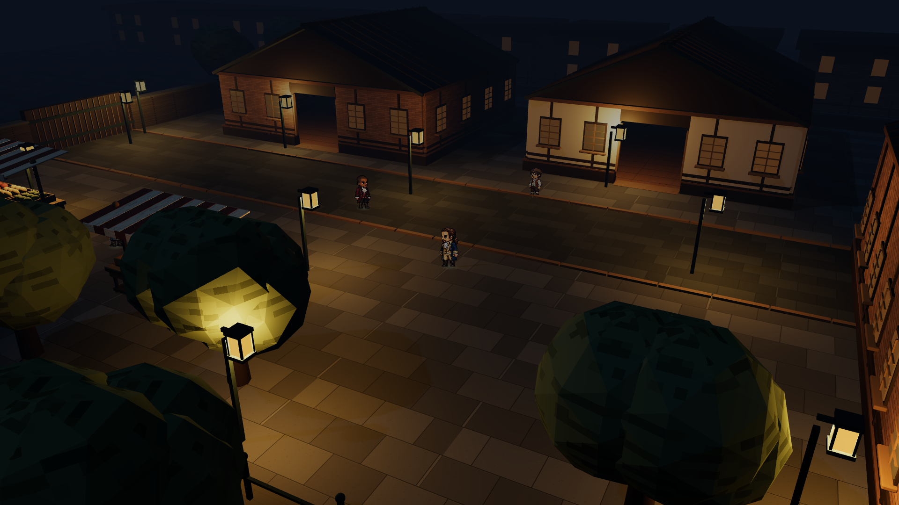
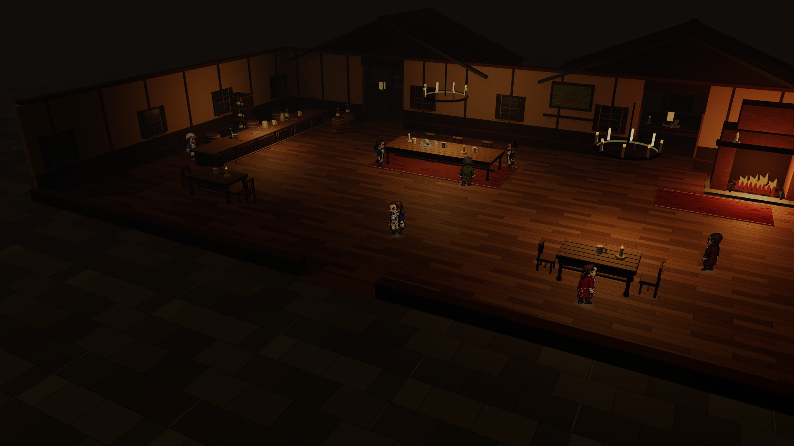
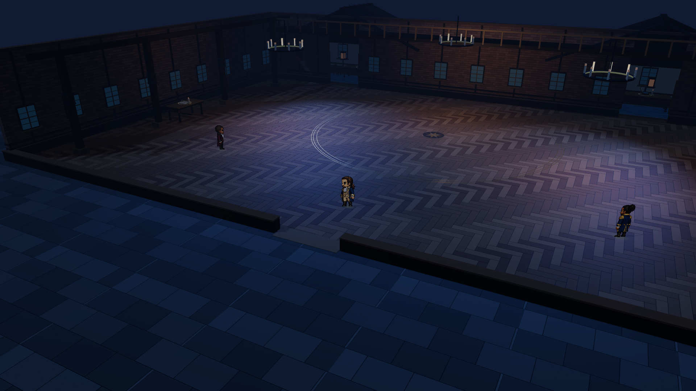

# 夜色与门口透视交付 · 2026-11-04

[纽约体验](http://127.0.0.1:1776/?experience=3d&scene=street) · [酒馆体验](http://127.0.0.1:1776/?experience=3d&scene=tavern) · [舞会体验](http://127.0.0.1:1776/?experience=3d&scene=ballroom) · [修改与验收](../../docs/2026-11-04-scene-atmosphere.md)

| 场景 | 模型 | 画面 |
| --- | --- | --- |
| 纽约夜街 | [GLB](models/hamilton-street-atmosphere-2026-11-04.glb) | [PNG](screenshots/street.png) |
| 烛火酒馆 | [GLB](models/hamilton-tavern-atmosphere-2026-11-04.glb) | [PNG](screenshots/tavern.png) |
| 蓝光舞会 | [GLB](models/hamilton-ballroom-atmosphere-2026-11-04.glb) | [PNG](screenshots/ballroom.png) |

模型包含完整建筑、屋顶、局部光源及每场四个收藏品。环境光、雾、曝光、角色、门口透视与连续行走在体验页查看；外部 GLB 查看器的灯光衰减会有差异。

其他实际验证画面：[墙外贴墙，140%](screenshots/street-wall-outside-140.png) · [街区边界，140%](screenshots/street-boundary-140.png) · [进入后室，140%](screenshots/tavern-back-room-140.png)。

`tests.log` 为最终 217 项检查结果；`build.log` 为构建及中英检查；`model-validation.json` 记录三个模型的 SHA-256、屋顶/封口及收藏品节点检查。`focused-tests.log` 为早期专项检查，最终以完整测试日志为准。`before/` 保留本轮修改前的源码快照。
