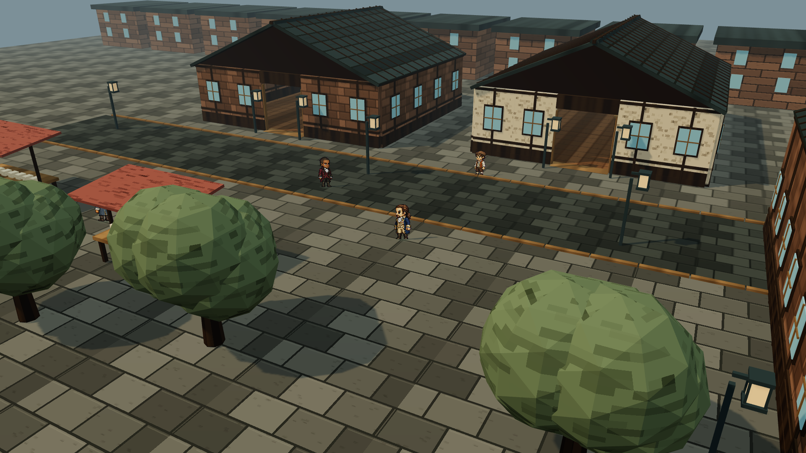
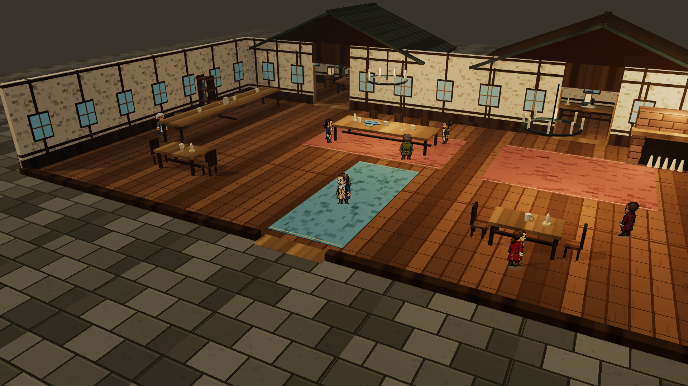
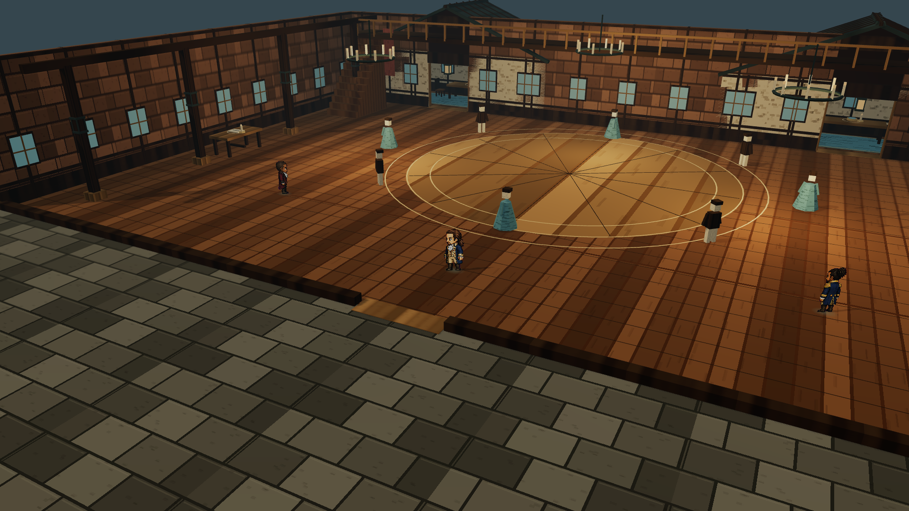

# 三场景模型交付 · 2026-11-02

[打开 3D 体验页](http://127.0.0.1:1776/?experience=3d&scene=street) · [完整验收说明](../../docs/2026-11-02-scene-experience.md)

| 场景 | 静态 GLB 模型 | 实际渲染画面 |
| --- | --- | --- |
| 纽约街头 | [下载模型](models/hamilton-street-2026-11-02.glb) | [查看画面](screenshots/hamilton-street-view.png) |
| 酒馆 | [下载模型](models/hamilton-tavern-2026-11-02.glb) | [查看画面](screenshots/hamilton-tavern-view.png) |
| 舞会 | [下载模型](models/hamilton-ballroom-2026-11-02.glb) | [查看画面](screenshots/hamilton-ballroom-view.png) |

每份模型包含完整建筑、屋顶及四件收藏品；静态 GLB 不包含运行时像素人物、寻路、墙面遮挡及收藏逻辑。互动功能请使用体验页，源文件位于 `src/sceneExperience/`。舞会简化宾客与楼上回廊布景属于第一版造型。

`model-validation.json` 记录 GLB 字节数、节点数、收藏品数与 SHA-256。`tests.log` 为 206 项通过的测试日志；`build.log` 为通过的构建日志。`before/` 保存本次修改前已有入口文件的快照。

仅本地交付，未上线。收藏品已预留剧情标签，尚未接入支线与结局。
