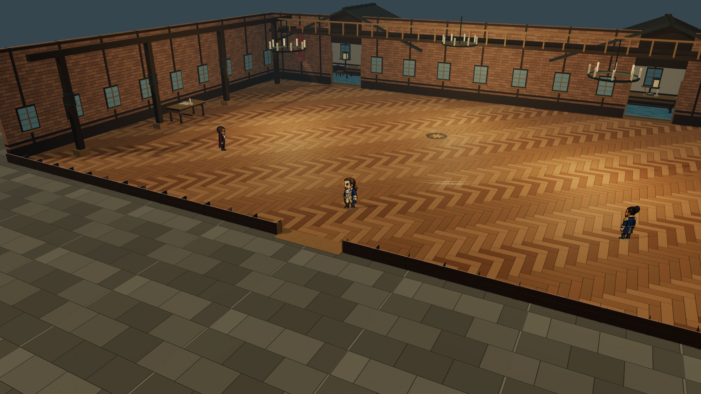
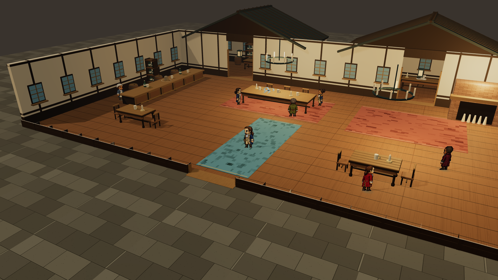
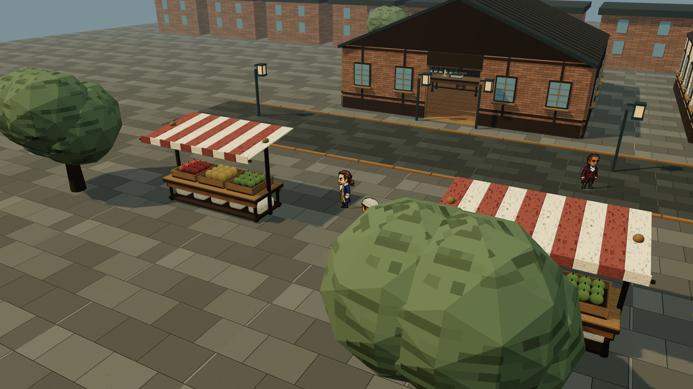

# 场景精细化交付 · 2026-11-02

后续低墙封口修复与 100%–140% 视距范围已更新，当前模型见 [最新交付](../scene-wall-cap-fix-2026-11-02/README.md)。本目录保留上一轮验收记录。

[打开体验页](http://127.0.0.1:1776/?experience=3d&scene=ballroom) · [修改与验收](../../docs/2026-11-02-scene-experience-polish.md)

| 场景 | 模型 | 实际渲染 |
| --- | --- | --- |
| 纽约街头 | [GLB](models/hamilton-street-detail-2026-11-02.glb) | [PNG](screenshots/hamilton-street-detail-view.png) |
| 酒馆 | [GLB](models/hamilton-tavern-detail-2026-11-02.glb) | [PNG](screenshots/hamilton-tavern-detail-view.png) |
| 舞会 | [GLB](models/hamilton-ballroom-detail-2026-11-02.glb) | [PNG](screenshots/hamilton-ballroom-detail-view.png) |

模型保留完整墙体、屋顶和每场四件收藏品。舞会楼梯及粗糙几何宾客已删除；回廊保留为布景。GLB 不包括页面交互与运行时像素人物，验收连续进门、遮挡、收藏品和缩放请打开体验页。

`before/` 保存改动前源文件快照。`tests.log`、`build.log` 保存测试与构建结果。`model-validation.json` 保存导出文件结构检查与校验值。
