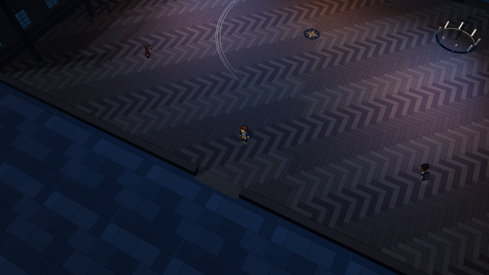

# 三场景离线包 · 2026-11-04

[可转发 ZIP](Hamilton-Scenes-Offline.zip) · [解压后的 HTML](Hamilton-Scene-Review/Hamilton-Scenes.html) · [使用说明](Hamilton-Scene-Review/使用说明-README.txt)

- ZIP：14,414,291 字节，包含 HTML、中英使用说明、Three.js MIT 许可证。
- HTML：19,701,771 字节。程序、样式、8 张常规/俯视人物原始图集均内嵌；使用系统字体，没有外部字体或样式依赖。
- 保留最新三个场景、100%–140% 缩放、行走、门洞透视、收藏品开关/查看、四种语言、PNG 保存及 GLB 导出。
- 单独场景演示，不包含完整主线剧情、音乐、配音，也未发布线上。

发送副本已保存到：`/Users/fangjie/Downloads/Hamilton-三场景离线体验-2026-11-04.zip`，与原包 SHA-256 一致。

## 验证

`npm test`：218 项通过。`npm run build`：通过，含 100 个文件的中英检查。`npm run scenes:pack`：通过。

重新解压至与项目无关的临时目录。浏览器工具的安全策略拒绝 `file://` 协议，因此没有声称已直接双击实测；改用只服务该解压目录的 `127.0.0.1:1791` 验证同一份 HTML。页面 CSP 禁止网络连接，服务日志只有 HTML 本身的一次 GET，没有图片、脚本或字体的外部请求。

实际检查：三个场景切换、行走、140% 缩放、通过门洞到达酒馆后室、收藏品模型与附文、显示开关、四种语言切换不重置位置、俯视人物图集、PNG 保存、GLB 导出。浏览器 error 日志为空。导出的舞会 GLB 结构有效，含四件收藏品。

`offline-audit.json` 记录脚本/样式内嵌与图集校验；`manifest.json` 记录原图与包的哈希；`tests.log`、`build.log`、`pack.log` 记录执行结果。

转发流程：发送 ZIP → 对方解压 → 在电脑浏览器打开 HTML → 切换场景并探索。
