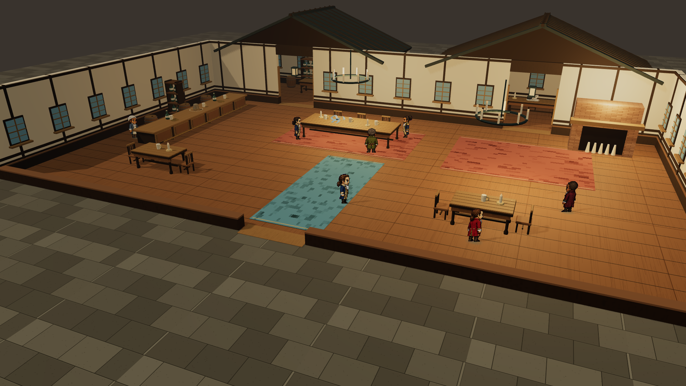

# 低墙修复交付 · 2026-11-02

后续高墙柱头的共面闪烁已修复，当前模型见 [最新交付](../scene-wall-crown-fix-2026-11-02/README.md)。本目录保留低墙修复记录。

[打开酒馆体验](http://127.0.0.1:1776/?experience=3d&scene=tavern) · [修改与验收](../../docs/2026-11-02-scene-wall-cap-fix.md)

缩放范围 100%–140%；三场景低墙均有独立墙基和完整顶盖。本目录模型替代上一轮模型用于当前验收，旧目录保留历史记录。

| 场景 | 最新静态模型 |
| --- | --- |
| 纽约街头 | [GLB](models/hamilton-street-wall-cap-2026-11-02.glb) |
| 酒馆 | [GLB](models/hamilton-tavern-wall-cap-2026-11-02.glb) |
| 舞会 | [GLB](models/hamilton-ballroom-wall-cap-2026-11-02.glb) |

GLB 包含完整建筑、屋顶和每场四件收藏品。行走、动态遮挡、像素角色与收藏交互由体验页提供。

`before/` 为修改前源文件快照；`tests.log` 和 `build.log` 为完整验证日志；`model-validation.json` 记录模型大小、节点检查与 SHA-256。
