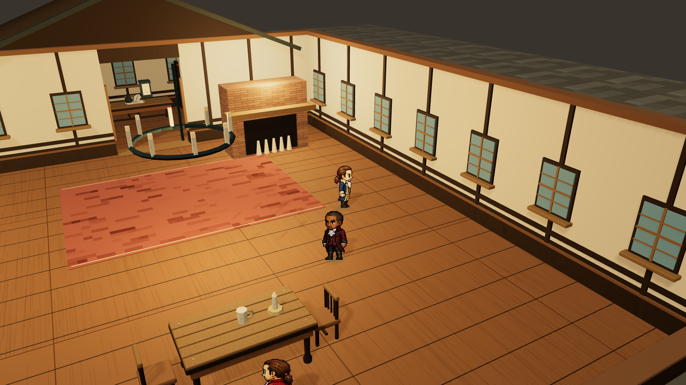
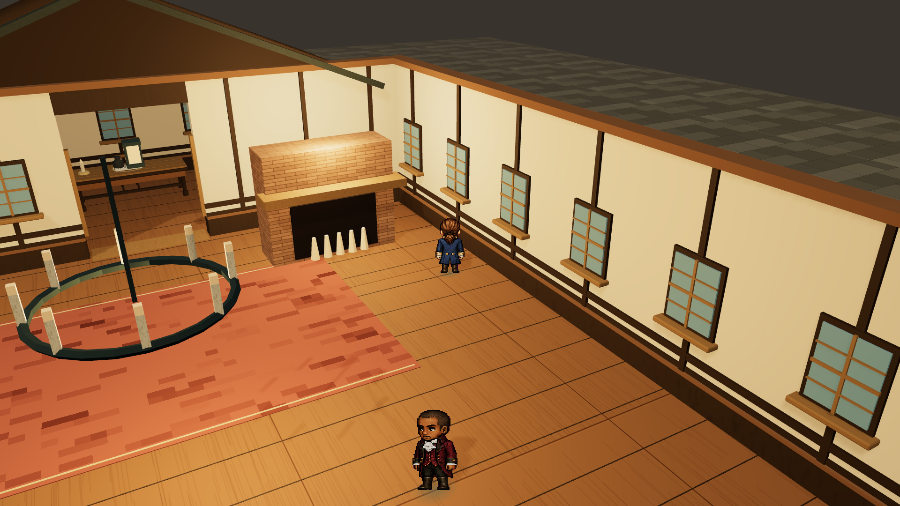

# 高墙柱头修复交付 · 2026-11-02

这是墙顶修复的历史快照；[最新夜景、酒馆与门口透视版本](../scene-atmosphere-2026-11-04/README.md)继续保留本次修复。

[打开酒馆体验](http://127.0.0.1:1776/?experience=3d&scene=tavern) · [修改与验收](../../docs/2026-11-02-scene-wall-crown-fix.md)

修复高墙墙板与木柱顶面的重叠。缩放仍为 100%–140%，低墙保留完整封口。

| 场景 | 最新模型 |
| --- | --- |
| 纽约街头 | [GLB](models/hamilton-street-wall-crown-2026-11-02.glb) |
| 酒馆 | [GLB](models/hamilton-tavern-wall-crown-2026-11-02.glb) |
| 舞会 | [GLB](models/hamilton-ballroom-wall-crown-2026-11-02.glb) |

模型包括完整建筑、屋顶与每场四个收藏品。连续行走、遮挡和像素角色在体验页验收。

140% 视距、相近位置的修改前后对照：

regression-before.log 保留原模型复现失败；focused-tests.log、tests.log、build.log 保存修复后验证；model-validation.json 记录模型节点与校验值。before/ 保存源文件快照。
