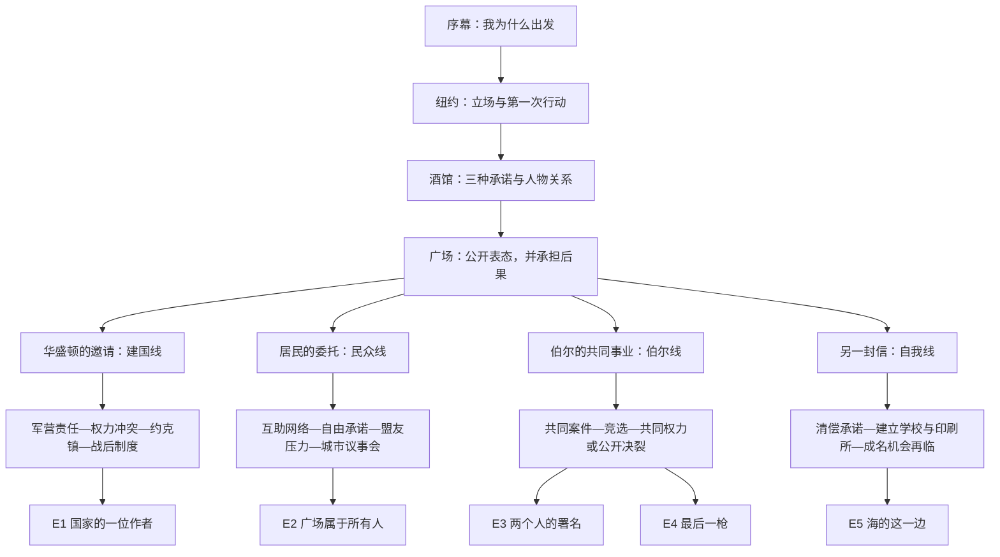

# 全游戏多路线与五结局提案

日期：2026-10-27。状态：策划提案，未确认、未接入游戏。取代只在军营／约克镇内分支的旧草模。

## 1. 整体形式：四条人生路线，五个主结局

保留共同篇「序幕—纽约—酒馆—公开辩论」，公开辩论后逐步进入四条专属路线。路线改变主要人物、核心冲突、可玩章节与最终生活，不只改变结算称号。

| 路线 | 主要人物 | 主题 | 主结局 |
|---|---|---|---|
| 建国线 | 华盛顿、拉法耶特 | 如何获得并约束权力 | E1 国家的一位作者 / An Author of the Nation |
| 民众线 | 劳伦斯、穆利根、市民 | 革命的承诺究竟包含谁 | E2 广场属于所有人 / A Square for Everyone |
| 伯尔线 | 伯尔 | 两个有野心的人能否互相容纳 | E3 两个人的署名 / Two Names, One Charter；E4 最后一枪 / The Last Shot |
| 自我线 | Hamilton、Eliza 的书信、曾受帮助的人 | 没有历史性的地位，人生还可以怎样成立 | E5 海的这一边 / This Side of the Sea |

时代与战争构成共同背景；各线可以改变 Hamilton 的职业、战友关系、政治立场与生死。约克镇是建国线的重要篇章，在其他线中可通过消息、伤兵归来、物价变化、往来书信等影响剧情，不要求所有玩家指挥同一场战役。

不设唯一真结局。建国、社会改革、合作与个人生活各有所得与代价。悲剧线由连续冲突和明确的不可逆决定形成，普通操作失误不决定角色死亡。

## 2. 分支怎样产生

采用「前期倾向 → 具体邀请 → 自愿承诺 → 专属章节 → 后果」的结构。

- 前期数值让某些人更愿意邀请你，让某些行动更容易成功。
- 关键事件证明你实际做过什么，例如完成互助委托、承认一处错误、为盟友承担损失。
- 分线发生在一次有实际内容的任务中：接受职务、留在街区、与伯尔共办案件、兑现另一份私人承诺。
- 可以同时满足多条线的进入条件。此时由玩家决定承担哪一项工作，不按最高数值自动分配。
- 每条线第一段专属剧情结束前允许一次有剧情承接的转向。完成关键承诺后，主要路线固定。
- 不在最终一幕放一个可以无视前文、任选五个结局的菜单。

共同篇应约占一次游玩内容的三分之一到五分之二，其余是专属章节与结局。这是内容比例目标，不是已经测量的游戏时长。

## 3. 数值、事件与结局分工

保留已有五项长期属性，改变它们在专属章节中的用途：

| 属性 | 路线用途 | 设计边界 |
|---|---|---|
| 锐气 | 争取主动权、公开反对、冒险行动、自主创作 | 高锐气可以走任何路线；不等于自私或悲剧 |
| 影响力 | 接到邀请、组织公众、筹资、传播文章、参与政治 | 声望不等于民众信任；违约会改变具体支持者 |
| 华盛顿信任 | 建国线的职责范围、独立判断权限、战后政治背书 | 进入军营后才充分成长，不能拿未接触华盛顿前的信任锁住建国线 |
| 伯尔尊重 | 坦诚交流、相信判断、危机担保、平等合作 | 高尊重与高竞争可以共存 |
| 伯尔竞争 | 同台竞逐、争夺位置、相互比较、公开冲突 | 高竞争本身不触发决斗 |

另外记录少量具体事件，不再增加大量人格分数：

- 承诺：是否承诺保护居民、扩大自由、共同承担风险。
- 行动：是否兑现、付了什么代价、伤害或帮助了谁。
- 关系：是否分享功劳、承认错误、接受对方的独立立场。
- 边界：是否曾主动拒绝地位、名誉或机会，以维护另一份具体承诺。
- 关键决裂：是否泄露盟友的私人材料、公开羞辱、拒绝补救与调解。

这些记录应能在人物回信和故事记录中被玩家读到，不能都是不可解释的隐藏计数。

下文数值是首轮门槛提案。进入门槛尽量取自现有主线能达到的范围；尚未作为新版全剧情数值表完成枚举或试玩验证。旧局部模型的 29,160 组检查与本方案无关。

## 4. 共同篇：每一章都给后面的路线埋因果

### 序幕：名字为何值得被记住

读完信后增加一个没有路线锁定的自我表达：追求被看见、做成重要的事、让他人拥有选择。结尾由 Eliza 回读，比较当初的愿望与后来生活。

这次选择不直接决定职业，也不要求玩家第一次就知道该攻略谁。

### 纽约：说的话与做的事第一次发生区别

保留报童、街头争论、与伯尔初见。

- 公开表态让影响力和锐气更容易增长，为建国、公众动员与伯尔竞争提供机会。
- 追问和观察建立伯尔尊重，为合作提供基础。
- 还报纸可以连接印刷铺与街区居民；其作用是让一个具体的人以后愿意介绍你，不是某结局唯一钥匙。
- 增加一项主线可见的小行动：发布一份消息前核实，或者帮助处理一次居民委托。玩家在这里留下第一次真实工作记录。

### 酒馆：三个人提出三种需要兑现的承诺

- 劳伦斯追问自由包含谁：为民众线埋下权利承诺，也会在建国线形成理想与制度进度的冲突。
- 拉法耶特追问怎样与盟友共同工作：为建国线合作、伯尔线对等关系提供呼应。
- 穆利根提供印刷、补给、动员的实际任务：让前面的选择成为次日行动，建立居民网络或工作信誉。
- 增加与伯尔的主线交流，使合作或竞争路线不依赖找到隐藏批注。
- Eliza 以一封来信出现，询问战争与成名之外尚未完成的事情，给自我线足够早的存在感。她的记录者身份由此贯穿各线。

路线承诺的关键选择不使用十秒超时自动沉默；普通谈话仍可保留节奏感。玩家不应因阅读速度而失去整条人生线。

### 广场：不仅赢得辩论，还要回答接下来做什么

保留辩论，但将表现得分与人生路线分开。普通失拍降低声势或改变场面，不直接取消某条主线。

辩论后增加「散场之后」：

- 华盛顿的代表请你提交一份真正可用的报告。
- 劳伦斯和穆利根邀请你处理居民提出的具体问题。
- 伯尔邀请你共同承办一件有政治风险的案件。
- Eliza 的来信使另一份拖延已久的承诺需要答复。

根据前文，邀请的语气、条件和承担成本不同。玩家先体验一段具体任务，再选择继续投入。此处进入专属篇。

## 5. 建国线：成为国家的一位作者

**进入方式。**影响力约 25 以上，或完成一份核实充分的报告，可以取得推荐；玩家接受正式职责。低声望者通过报告证明能力，不必靠搜集隐藏加分。

**专属第一章：笔与命令。**军营成为这条线的核心。整理军令后，还要处理真实的补给冲突与责任归属：承认缺口、寻找替代安排，或者让下属承担压力。正确答案与守信不是一回事。结果改变信任及后续可用人手。

**专属第二章：你可以不同意将军。**Hamilton 与华盛顿在职责或作战目的上发生冲突。信任约 25 时可提出独立方案；不足时可先承担一次额外任务证明判断，或接受更受限的职责。玩家可以坚定反对，同时保持可靠，避免把本线写成服从攻略。

**专属第三章：约克镇。**此前积累决定你怎样获得指挥权、有哪些支持、对谁作过承诺。建国线内部保留战术变化，但这些变化服务这条人生路线。普通成绩差不强迫转入悲剧；责任处理与战后解释继续影响未来。

**专属第四章：胜利之后。**从赢得一场行动，进入如何约束掌权者的政治冲突。玩家决定公开账目、分配功劳、承认地方代表的参与权，以及自己愿接受怎样的职位限制。

**E1 国家的一位作者 / An Author of the Nation。**Hamilton 进入新国家的制度建设，拥有实权，也被自己支持的规则约束。高信任使他获得更强背书，高影响力使他能公开主导，低声望但可靠者则是重要起草者。主结局共同点是他主动承担建立公共制度的职责，并完成对应章节。

**所得与代价。**获得改变国家的权力，必须在妥协与联盟中推进理想。劳伦斯早期提出的问题仍会要求回答，不能用一场战争胜利宣称所有自由承诺已经兑现。

## 6. 民众线：革命的中心留在街上

**进入方式。**先作出保护居民或扩大自由的公开承诺，再完成一次相关实际委托。影响力约 30 可直接召集更大范围的人；不足时从街区组织开始。承诺与行动均在主线出现。

**专属第一章：面包先于口号。**玩家留在纽约，与穆利根建立印刷、物资与互助网络。粮食、钱、纸张有限，必须决定服务谁，并向受影响的人解释。早期帮过的人可以介绍资源，但不存在只有帮过报童才可通关的条件。

**专属第二章：自由是否有例外。**劳伦斯要求兑现酒馆里的权利承诺。当承诺影响资助者的利益时，玩家需要选择并筹措替代支持。利益冲突必须具体发生，不能只靠一次正确表态获得道德奖励。

**专属第三章：战争中的另一条战线。**军营的征用、伤员、物价与军事消息进入城市。玩家面对的是居民安置、信息公开、罢工或征用谈判；约克镇可以通过消息与归来的人改变局势。此线不强制获得军衔或指挥攻城。

**专属第四章：谁有资格坐进会场。**战争后的新权力试图排除曾付出代价的人。玩家把互助网络组织为代表机制，争取一个有真实参与权的地方议事会。高影响力扩大范围，守约记录决定哪些群体愿意授权。

**E2 广场属于所有人 / A Square for Everyone。**Hamilton 成为民众授权的公共代表，或选择把代表位置交给共同组织者，自己继续办报。结局的核心成果是一个能容纳此前被排除者的公共空间，不是个人官职高低。

**所得与代价。**得到具体人群的信任，失去一部分军政精英的支持与快速升迁机会。不同承诺是否兑现决定哪些人物出现在最后一场议事会上。

## 7. 伯尔线：合作与竞争贯穿整条人生

**进入方式。**伯尔尊重约 30，或竞争约 20，触发不同形式的邀请：前者邀请合作，后者提出一起承办一件难题以较高下。玩家共同署名接受案件后进入此线。

**专属第一章：同一份案卷。**两人共同处理一场涉及商人、居民和公共权力的争议。选择公开事实、保护证人、分配工作与功劳。Hamilton 可以强势，也能对伯尔诚实。

**专属第二章：同一场竞选。**两人逐渐拥有不同支持者。一个争议席位、一次公开演说和一份竞选承诺，使他们必须决定是否共享筹码。尊重决定能否坦诚协商；竞争使对方成为有分量的同伴或对手，而非纯粹惩罚值。

**专属第三章：只有一个位置。**核心职位出现。玩家可以支持对方、提出共同执政的限制，或独自争取。真正决定分裂的是是否违约、利用私密材料、公开羞辱，以及是否允许对方拥有独立立场。

### E3 两个人的署名 / Two Names, One Charter

推荐条件：尊重约 45 以上，至少两次履行重要合作约定，并在权力冲突中接受对双方都有效的限制。

如果尊重不足，应在终局前提供有成本的修复章节：公开纠正自己的指控、交还本属对方的功劳、承担共同案件的赔偿或政治损失。修复靠行动，不靠重复送礼或刷对话。尊重与补救条件的具体数值需在剧情节点全部确定后配平。

结局中两人仍有分歧，却共同签署一份约束权力的文件，成为政治伙伴或互相制衡的长期对手。高尊重、高竞争可以进入这个结局。

所得是同行者与互相校正的力量，代价是 Hamilton 必须接受自己不能独占舞台，也不能替伯尔作决定。

### E4 最后一枪 / The Last Shot

由连续关键事件形成：利益冲突升级 → 至少一次严重背约或公开伤害 → 对方要求解释 → 玩家拒绝实质修复 → 调解出现 → 明确接受致命决斗。

竞争约 40 可加强决裂场景，但数值本身不能替代上述事件。高尊重也可能被背叛击穿；高竞争也可以被坦诚约束。

在此结局中 Hamilton 死于决斗，伯尔活下来，却失去了共同未来与曾经希望得到的认可。Eliza 面对同一份共同案卷，读出被两人先后删掉的句子，回扣纽约初见时关于公开言论会留下来的提醒。

这段不是射击反应小游戏，也不由一次按键失败决定生死。赴约前清楚交代致命风险，并有代价明确的撤回与修复选择。玩家可以停止升级冲突。

**和平分手的去向。**不愿继续合作、也不愿决斗时，可以进入一段有长度的离开公共竞逐与重建生活章节，接入自我线的后半段，最后获得 E5 的对应变体。不能点击退出争执后立刻播放私人生活结局。

## 8. 自我线：主动决定什么值得留下

**进入方式。**前文至少两次为具体关系、工作或承诺划定边界；或者在广场后的转折中选择完成这些被拖延的事情，并经过相应过渡章节。锐气与影响力没有低值要求。

**专属第一章：没有被写进演说的事。**清偿欠款、完成一篇承诺过的文字、回应被忽视的来信。玩家面对自己追求名声时留下的现实后果。这是一段主动收回人生选择权的过程。

**专属第二章：一间学校，一台印刷机。**Hamilton 与 Eliza 的书信、普通人的参与共同建立一个小规模而具体的事业。玩家安排有限时间与钱，决定教育、出版、保存他人故事的优先级。成功不通过战争荣誉衡量。

**专属第三章：名字再次被叫到。**已经建立的事业让 Hamilton 再次得到有吸引力的政治或军事邀请。这里检验前文边界：他可以接受一次有限的公开发声，也可以拒绝长期职位，但必须处理好已承担的责任。若在此时彻底离开，应有新的过渡，而不是瞬间结算另一条未经历的路线。

**E5 海的这一边 / This Side of the Sea。**Hamilton 没有成为最显赫的政治人物，却作为教师、作者或出版者活下来，完成出发时尚未理解的另一种愿望。Eliza 的记录最终包含他自己仍在继续写的页码。

高锐气可以表现为坚持写作与办学，高影响力可以扩大读者范围；这条线不要求玩家故意把属性玩低。通过伯尔线和平离场进入时，会保留共同事业曾经存在的痕迹；从共同篇主动进入时，则强调较早认清自己的选择。

## 9. 五个结局的判定原则

主结局根据玩家实际完成的专属叙事和关键事件解析，数值为前面的邀请、权限和解决方案服务。

| 结局 | 必要经历 | 不应直接触发它的条件 |
|---|---|---|
| E1 | 完成建国线，承担并落实制度性职责 | 单独拥有最高信任 |
| E2 | 完成民众线，兑现授权与参与机制 | 单独拥有最高影响力 |
| E3 | 完成伯尔共同事业，守约或完成实质修复，接受对等约束 | 单独把尊重刷满 |
| E4 | 经历决裂链条，拒绝修复与调解，明确接受致命决斗 | 高竞争、低分、一次误操作 |
| E5 | 完成自我线事业，选择具体的人生边界 | 低锐气、漏掉支线、没有资格走其他线 |

最终不扫描五个数值选最高项，不设「属性全高默认真结局」。多个条件都满足时，已经发生的路线承诺和事件决定故事。

每个主结局可附少量关系回声，例如华盛顿是否理解你的离开、劳伦斯是否认可承诺、伯尔是否仍有来信、报童是否成为印刷所的合作者。这些是结局变体，不额外承诺十几条完整主线。

## 10. 路线边界与防止突兀的规则

1. 所有路线在共同篇中至少出现两次人物或事件铺垫。
2. 首次邀请条件不满足时，至少有一次明示、有限、有实际内容的补足机会。
3. 重要人物不按路线消失；他们会通过相遇、请求和书信回应玩家的不同生活。
4. 初次专属章节结束前可转向一次，理由来自实际冲突。后期转向只通过写好的过渡章节。
5. 伯尔线的合作、决裂、和平分手是明确剧情状态，不用一个临时结局分数替代。
6. 保留章节重开与一次性奖励，新增路线检查点。新路线不能继续沿用「所有章完成后必到约克镇」的线性假设。
7. 每条路线都要覆盖普通成功、普通失误、拒绝高风险操作的完整通路。只有明确选择的严重事件才改变生死。
8. 长期缺少操作技巧的玩家仍可以通过负责的决策走到有意义的结局。
9. 结局前无需出现结局名称；通过邀请、承诺、人物反应让方向可理解。

## 11. 内容与制作范围

共同篇保留现有场景、主要角色与双语框架。四条线需要专属章节与事件；可以复用同一城市、酒馆、印刷铺或军营在不同年代与状态下的空间。

建国线继续使用军营与约克镇，但必须补足战后制度章节。民众线扩展街区委托与议事会。伯尔线扩展案件、竞选和决裂。自我线扩展书信、学校与印刷事业。

Eliza 的叙事身份需要贯穿共同篇和专属篇，不能只在自我线临时出现。可优先通过书信与记录呈现，继续尊重现有影中旁白美术规则；若未来增加可见的现实角色，应另行设计其角色形象与说话表现。

本提案中的路线标签和事件概述属于策划说明；正式新增对话、选项、标题和动态反馈仍按 `BiText` 中英成对维护。五个主结局名称已提供中英文概念名，具体台词尚未进入生产稿。

本次完成的是全游戏叙事结构与路线因果方案。尚未编写完整双语剧本、各节点最终属性增减表、场景实现或配音，也未对新版路线做数值可达性穷举。

逻辑链：共同篇形成愿望与关系 → 行动带来不同邀请 → 接受一份有后果的承诺 → 经历专属人生冲突 → 对权力、公众、伙伴或自我作出最终承担 → 五种人生结局。
