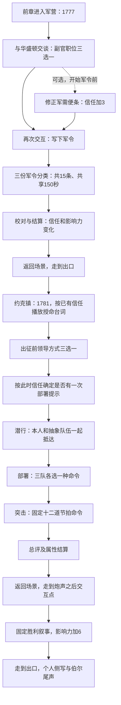

# 军营与约克镇玩法现状

核对日期：2026-10-27。版本：本地 `package.json` 0.5.2。

用途：为后续大改提供现有规则底稿。以下区分现有实现、由规则推出的结果、策划判断；不代表已选定新版设计。以当前三维主线源码为依据，未修改玩法或发布版本。

## 1. 当前产品结构

叙事弧线是：渴望指挥 → 接受副官职责 → 用军令证明可靠 → 多年后获得指挥机会 → 带队攻取堡垒 → 回顾自己的野心与责任。

实际操作是：三维场景移动与交互 → 对话选项 → 军令分类 → 场景出口 → 对话选项 → 面板潜行 → 固定答案部署 → 十二次节拍输入 → 数值结算 → 战后对话 → 个人结局。

当前军令、潜行、部署、突击全部由覆盖在三维场景上的活动面板承载。三维营地和堡垒负责移动、交互位置及氛围，不直接模拟这些活动的军队与战斗。

## 2. 军营：第二幕第一场「笔，比军刀更近」

### 2.1 进入与空间流程

- 剧情年份为 1777，地点为大陆军总部。
- 场景中的主线 NPC 为华盛顿。
- 两个必做交互按顺序开放：「总司令的提议」→「写下军令」。在当前三维布局中，两者共用华盛顿身边同一交互位置，并非两处独立工作站。
- 完成提议后可以暂时离开，做可选发现，再回来开始军令。
- 军令结算按钮关闭活动并提交成绩，之后仍需走到场景出口，才进入约克镇。按钮文字「翻过战争中的几年」并不直接完成章节切换。
- 本章对白选项不计时，没有进入军营或接受任务的属性门槛。

### 2.2 职位选择：表达态度，改变属性

影响力达到 30 时，初见对话改为华盛顿已听说 Hamilton 的文章与街头辩论；不改变后续任务。

| 选择 | 华盛顿信任 | 锐气 | 路线结果 |
|---|---:|---:|---|
| 接受副官职位，先承担责任 | +15 | -5 | 进入军令活动 |
| 接受，但明确争取未来指挥机会 | +8 | +5 | 进入军令活动 |
| 要求立刻获得指挥权 | -8 | +15 | 仍被要求整理军令 |

所有属性限制在 0–100。正常主线进入军营时信任为 0，因此第三项显示的 -8 实际被下限截断，结果仍是 0。

**实际选择空间：**不同自我表达与属性取舍，三条路线都会做相同副官工作。

### 2.3 可选发现：错置的军需便条

- 开放时间：完成职位交谈之后、开始「写下军令」交互之前。
- 内容：外封目的地与正文不一致，华盛顿直接说明正文才是正确目的地。
- 只有一个修正选项，完成后信任 +3；无错误答案、解谜判定或资源消耗。
- 之后在军令开场、约克镇授命和结局中可有文字回顾。
- 开始主线军令后，该发现失效为普通描述；不可补领奖励。重复查看不重复奖励。
- 旧版「文件末尾签名」交互已移除。

**实际作用：**鼓励留意场景细节，并提供少量信任与后文呼应。

### 2.4 军令活动：读卡片、分类、提交、校对

三轮固定内容：

| 轮次 | 军令题材 | 信息内容 |
|---|---|---|
| 1 | 北线补给 | 粮药、驻地、期限、护送人员、解除断粮目标 |
| 2 | 转移伤员 | 桥梁与渡口、担架队、重伤员转移目标、物资、期限 |
| 3 | 准备集结 | 时间、集结目标、地点、口粮弹药、通知清点人数 |

每轮 5 条信息，卡片已标明「目标／时限／人员／补给／地点」等类型。三个栏目固定为：

| 栏目 | 正确放入的信息 |
|---|---|
| 优先事项 | 目标、时限 |
| 执行任务 | 人员、补给 |
| 背景信息 | 地点、状况 |

操作循环：选择卡片并听读 → 点击栏目或按 1/2/3，亦可拖拽 → 提交前可更改 → 提交该轮 → 显示完整校对稿 → 下一轮。

时间与判定：

- 三轮共享 150 秒有效整理时间，不是每轮 150 秒。
- 朗读、校对、暂停和成长面板期间不扣整理时间。
- 可以在未分配完五条信息时提交；未分配与错放均不得分。
- 提交后显示正确分类，评分固定为第一次提交结果；没有本轮改错后重新得分。
- 时间耗尽时自动提交当前轮，查看校对后结束活动，不再继续剩余轮次。
- 总分 = 四舍五入（正确条目总数 ÷ 15 × 100）；未做到的轮次同样占总分分母。
- 活动开始时信任达到 8，提供整场共一次分类提示；玩家仍需自行放置，不自动提交，也不增加时间。

| 总分 | 华盛顿信任变化 | 记录 |
|---|---:|---|
| ≥80，即至少12条正确 | +10 | 精确整理 |
| ≥50且<80，即8–11条正确 | +4 | 匆忙整理 |
| <50，即0–7条正确 | -3 | 匆忙整理 |

另有影响力奖励 = 四舍五入（总分 ÷ 50），范围 0–2。

**失败处理：**错放的信息会被校正，超时由其他副官接手。军令始终发出，玩家始终能继续剧情。没有错误地点造成物资误送、补给不足或伤员状态变化的模拟。

**策划归类：**固定规则的信息分类小游戏。准确性决定评价；玩家不制定军令内容、安排资源、选择路线或调度人员。

## 3. 军营与约克镇的实际连接

当前跨章连接主要是：

1. 华盛顿信任：职位态度 + 可选便条 + 军令准确率。
2. 锐气与影响力：带入原有数值，并叠加本章变化。
3. 选择与完成记录：用于对白回顾、结局总结、一次性奖励和辅助使用记录。

下列内容没有跨章战场状态：哪一批补给是否送达、哪一队士兵被派往哪里、伤员是否转移、哪些路线已勘察、具体哪张军令出了错。

正常主线、跳过可选便条、军令满分的三条路线：

| 职位态度 | 军令前信任 | 军令后信任 | 进入约克镇时高信任授命 |
|---|---:|---:|---|
| 接受职责 | 15 | 25 | 有 |
| 争取未来指挥 | 8 | 18 | 有 |
| 立刻要求指挥 | 0 | 10 | 无 |

做便条则在上述信任上增加 3。全部路线仍获得指挥权。

**策划判断：**叙事中的成长是「从文书责任到现场指挥」，系统中的承接主要是「分类得分换信任，信任换提示与对白」。

## 4. 约克镇：第二幕第二场「终于，轮到你下令」

### 4.1 授命与出征选择

剧情年份为 1781。走近华盛顿触发「接过指挥权」。此时：

- 信任 ≥18：肯定其可靠，并表示相信他的现场判断。
- 信任 <18：仍授予指挥权，但强调按计划行动、对整支队伍负责。
- 修正过便条会被提及；锐气是否达到 55 决定 Hamilton 的补充表达。
- 上述对白变化不增加士兵、路线、技能、容错或指挥权限。

随后做一次不限时、无门槛的出征选择：

| 选择 | 华盛顿信任 | 锐气 | 影响力 |
|---|---:|---:|---:|
| 核对分工，等共同信号 | +5 | -3 | 0 |
| 自己走在最前面 | +2 | +9 | 0 |
| 说明共同目标 | 0 | +5 | +4 |

三项都有对应回应与结局回顾，但不直接切换潜行方式、队伍行为或突击指令。

**两个判定时刻必须区分：**授命台词在开始交互时判断；一次部署提示在出征选择后、活动实例创建时按信任 ≥18 判断。因此玩家可以听到普通授命，但靠出征选择获得提示。例如进入时信任 13，选择核对分工后变 18。

### 4.2 潜行：把自己和抽象队伍带到终点

- 面板上的一维线路，共 3 个哨岗、3 处掩体。这里没有三维地形寻路和真实巡逻实体。
- A/D 或左右方向键移动；Ctrl 蹲伏；E 切换队伍跟随／待命。鼠标有对应控件。
- 玩家用一个位置表示，整个队伍用另一个位置表示；没有每名士兵的独立状态。
- 站立速度 132、蹲伏速度 66（内部面板坐标单位／秒）。跟随时队伍追向玩家身后 28 单位位置。
- 守卫每 2.4 秒切换朝向，完整周期 4.8 秒，三处错开相位。
- 蹲伏只有靠近掩体才提供隐蔽；玩家与队伍的位置分别检查，使用共同蹲伏状态。
- 初始突袭优势 100。任一位置被某哨岗发现，该岗扣 20；同一岗本次活动最多扣一次。
- 因此突袭优势只有 100/80/60/40 四档，警戒 = 100 − 突袭优势。
- 本人与队伍都抵达右侧才进入部署。没有倒计时、生命、被捕、追击或失败重来。

**向下一阶段传递：**突袭优势及其反值警戒。会影响敌军士气初值和总评；不会改变巡逻后的部署题目或突击节拍难度。

### 4.3 部署：三道固定答案的命令匹配

每队可选待命、推进、包抄，确认前可修改；必须三队均已选择才能继续。没有部署倒计时。

| 队伍 | 已给提示 | 固定最优命令 |
|---|---|---|
| 一队／正面 | 牵制守军，阻止转向两翼 | 推进 |
| 二队／左翼 | 左通道已打开，绕至侧后 | 包抄 |
| 三队／右翼 | 仍有巡逻，先留预备队 | 待命 |

部署配合 = 四舍五入（匹配最优命令的队数 ÷ 3 × 100），只有 0/33/67/100 四档。

若活动开始时获得部署提示，则可选一队查看推荐命令，整场一次；不会自动更改已选命令。

确认后：

- 显示三档阵势描述：全部正确／部分正确／全部错误。
- 敌军士气 = 四舍五入（100 − 部署配合 × 0.55 − 突袭优势 × 0.15），限制到 0–100。
- 全部正确且无暴露：敌军士气为 30。
- 全部正确且三岗均暴露：敌军士气为 39，即视频中的状态。
- 进入突击准备页，玩家点击开始。

**实际选择空间：**找到固定正确组合。各部署方案不产生不同路线、兵力配置、风险收益或后续指令。

### 4.4 突击：固定十二轮节拍输入

| 顺序 | 指令 | 按键 |
|---:|---|---|
| 1 | 推进 | Space |
| 2 | 稳住阵形 | S |
| 3 | 左翼包抄 | A |
| 4 | 推进 | Space |
| 5 | 右翼支援 | D |
| 6 | 等待友军 | S |
| 7 | 侧翼接应 | A |
| 8 | 越过土垒 | Space |
| 9 | 保持联系 | D |
| 10 | 重新集结 | S |
| 11 | 进入堡垒 | Space |
| 12 | 守住阵地 | S |

单轮循环：朗读命令，暂停节拍计时 → 朗读结束或被跳过 → 游标开始移动 → 第一次有效指令输入或超时 → 显示反馈 850 毫秒 → 下一道命令。

- 朗读期间按任一指令键或点击对应按钮，仅跳过朗读；该次操作不作节拍判定。
- 正式判定目标为节拍开始后的 1200 毫秒。
- 按对键且误差 ≤100 毫秒：PERFECT；误差 >100 且 ≤250 毫秒：GOOD。
- 错键、超出窗口、错过输入：MISS。合法指令键第一次输入即消耗本轮机会，之后不可补按。
- PERFECT 权重 1，GOOD 权重 0.7，MISS 权重 0。
- 敌军士气每次分别下降 5、3.5、0。
- 士气归零不提前胜利，士气仍高不导致失败，也不调整后续指令。它是反馈指标，没有参与胜负或总评分公式。
- 十二轮全部完成后必定进入结果页，哪怕十二轮全部 MISS。

**实际考察能力：**识别指定按键、等待时机、准确输入；玩家不选择当前应当发出的战术命令。

### 4.5 总评、奖励与战后收束

设突袭优势为 S，部署配合为 T，十二轮判定权重平均值为 R（0–1）：

`战役总评 P = round(0.2 × S + 0.3 × T + 50 × R)`

| 项目 | 结算规则 |
|---|---|
| 战役表现 | 保存 P |
| 影响力 | +5 + round(P/10) |
| 华盛顿信任 | P≥70：+8；40≤P<70：+3；P<40：-3 |
| 锐气 | round((P−40)/10)，可能增减 |

由规则推出：

- 普通完整流程最低为 8 分：三岗暴露 S=40，部署全错 T=0，节拍全失 R=0。
- 潜行与部署全优、节拍全失，仍得 50 分。
- 视频的 38 分 = 40×20% + 100×30% + 0。其战役奖励为影响力 +9、信任 -3、锐气不变。
- 以上所有结果都显示堡垒已攻克；成绩区分个人表现，不决定战役胜负。

点击结算继续按钮才向主线提交结果，然后返回三维场景。玩家还需走到另一处「炮声之后」交互点，观看固定的攻克堡垒、围城继续及英军投降叙事；完成此段额外获得影响力 +6。随后走到出口进入个人结局。

战后没有清点士兵、治疗伤员、搜索战场或重组部队的操作。

## 5. 属性与记录究竟改变什么

| 状态 | 在这两章实际改变 | 当前没有改变 |
|---|---|---|
| 影响力 | ≥30 的军营初见对白；累计数值 | 军令内容、队伍配置、敌军行为 |
| 锐气 | ≥55 的出征前表达；结局标题 | 潜行速度、突击容错、战斗技能 |
| 华盛顿信任 | ≥8 的一次分类提示；≥18 的授命变体及一次部署提示；结局评价 | 是否得到指挥权、是否能进入约克镇、任务规模 |
| 军令分数 | 信任／影响力奖励、成绩记录、精确／匆忙标签、结局回顾 | 物资、人员、路线和战场事件 |
| 便条发现 | 信任+3、对白呼应、结局回顾 | 独立军事资源或战场能力 |
| 出征领导选择 | 属性变化、回应及结局回顾；可间接跨过提示门槛 | 潜行队伍行为、部署备选项、指令顺序 |
| 突袭优势 | 警戒显示、敌军士气初值、总评20%部分 | 后续地图、命令、计时难度 |
| 部署配合 | 阵势文字、敌军士气初值、总评30%部分 | 实体编队、作战路径、后续命令 |
| 节拍结果 | 本轮反馈、士气下降、总评50%部分 | 己方伤亡、阵地推进和战术分支 |
| 敌军士气 | 活动内显示反馈 | 胜负、结束时机、总评、后续战斗行为 |

传到后续主线的主要记录包括：职位选择、便条完成、军令总分、精确／匆忙标签、出征选择、战役总分、活动完成及是否用过辅助。

具体错放卡片、潜行暴露位置、三队部署、十二轮判定和敌军士气留在本场活动实例中，没有作为后续剧情的独立状态保存。

结局标题主要使用两个阈值组合：锐气 75、信任 18。约克镇总分通过属性奖励间接影响标题，并作为成绩在回顾中列出。伯尔关系沿用前章积累，这两章不直接修改。

## 6. 继续、重开与表现约束

- 主线任务必须按顺序完成，但成绩没有最低通过线。失败继续是当前明确设计。
- 可选便条可跳过，不阻塞主线。
- 每次活动结果与发现奖励只提交一次，重复交互不可刷属性。
- 重开本章恢复该章进入时的属性和选择；约克镇重开保留军营结果，回滚约克镇自己的选择与成绩。
- 当前没有军令轮次或约克镇阶段的中途存档／单阶段重试入口。
- 章节检查点是当前运行内状态；持久保存的是完成的个人结局用于展示，不能据此认定已有完整中途续玩存档。
- 暂停、语言切换与减少动态继续复用既有生命周期；语言切换不应重开活动或重置成绩。
- 后续任何玩家可见内容仍须中英配对。旁白只读正式 narrator 对话，不读操作规则或成绩。

## 7. 对大改范围的策划判断

以下是现状判断，不是新版方案：

1. **角色成长的题目已经成立。**军营是对细节负责，约克镇是对整队人负责，适合保留为两章的戏剧关系。
2. **目前军营到战场传递的是评价，缺少事件与资源。**军令里的粮食、伤员、路线没有在后续变成可感知的结果。
3. **目前“指挥”由两种操作构成：选固定正确部署、执行系统给出的命令。**玩家主动判断战况的空间有限。
4. **约克镇三阶段主要通过评分相连。**潜行和部署不会改变突击的内容，敌军士气也没有驱动战斗状态。
5. **失败影响自我评价，较少影响场内过程。**保留固定历史胜利与增加过程差异可以同时成立，当前尚未实现这种过程分化。
6. **空间主要承载交互入口。**如果大改目标是现场指挥，工作范围会涉及三维队伍表现、战场状态与活动规则的连接，而不只是替换面板美术。

重做时需要首先定义：玩家要做哪种判断；军营为战场准备什么；命令如何改变局面；失败留下什么后果。确定这些之后，再决定节拍、分类与潜行分别保留多少。

现有逻辑链：态度／分类准确率 → 信任与一次提示 → 潜行分、部署分、节拍分 → 综合分与属性变化 → 固定胜利叙事 → 个性化文字回顾。

## 8. 源码核对入口

- `src/data/chapters.ts:113`：军营与约克镇剧情、选择、章节出口。
- `src/story3d/StoryPlaces.ts:43`：当前三维交互位置及场景人物。
- `src/data/discoveries.ts:98`：军需便条；`:155`：失效时机；`:188`：后文呼应。
- `src/data/writing.ts:2`：军令栏目与三轮固定内容。
- `src/systems/WritingSystem.ts:6`：计时、评分与奖励。
- `src/ui/WritingActivity.ts:15`：朗读暂停计时、交互与校对。
- `src/data/yorktown.ts:5`：固定部署答案与十二道命令。
- `src/systems/YorktownSystem.ts:7`：潜行、部署、士气与综合结算。
- `src/systems/TimingSystem.ts:1`：1200毫秒目标及判定窗口。
- `src/ui/YorktownActivity.ts:24`：先朗读后节拍；`:95`：固定攻克表述。
- `src/systems/GrowthSystem.ts:5`、`src/story3d/StoryUI.ts:324`：活动创建时确定辅助。
- `src/story3d/StoryProgress.ts:58`：交互时评估对白；`:112`：活动结果提交；`:134`：出口与重开。
- `src/systems/StateSystem.ts:24`：属性上下限与一次奖励；`:96`：完成结局保存。
- `src/data/ending.ts:28`：标题阈值；`:54`：军令与战役回顾。

本次为静态规则梳理，未重新进行完整浏览器通关或音画体验测试。
